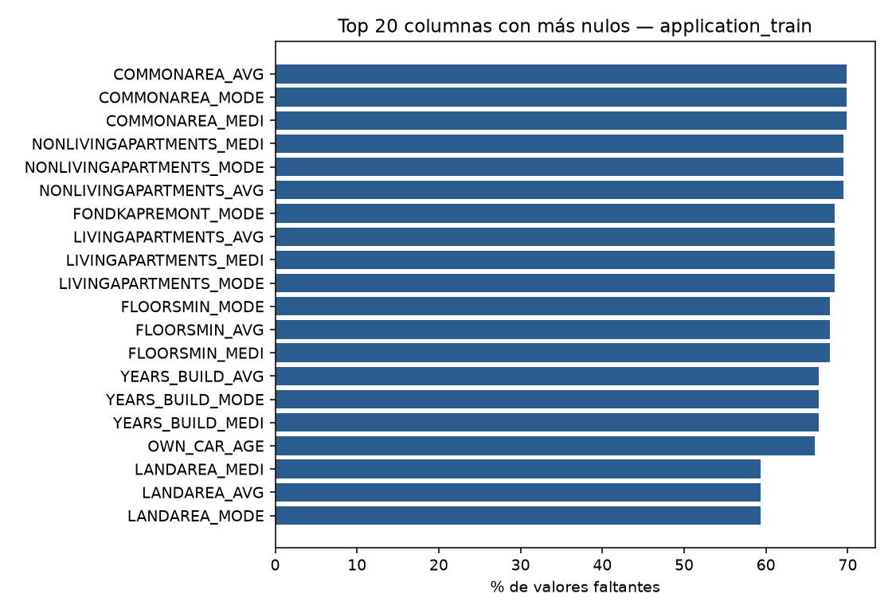
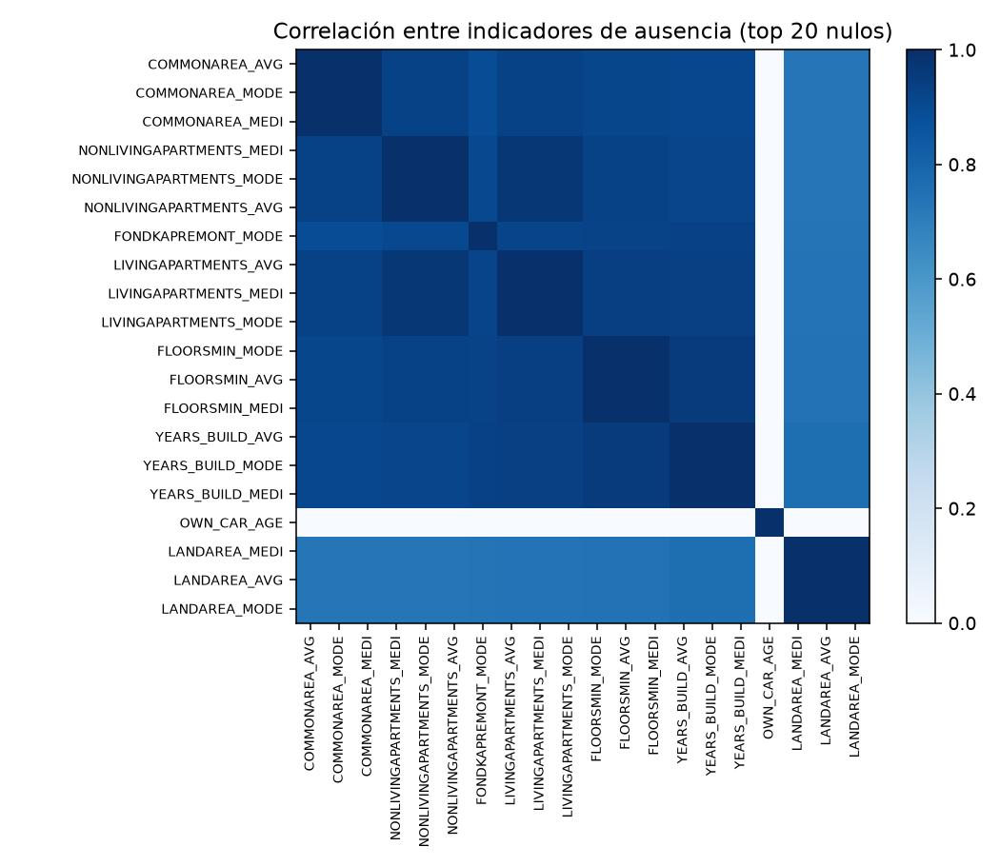
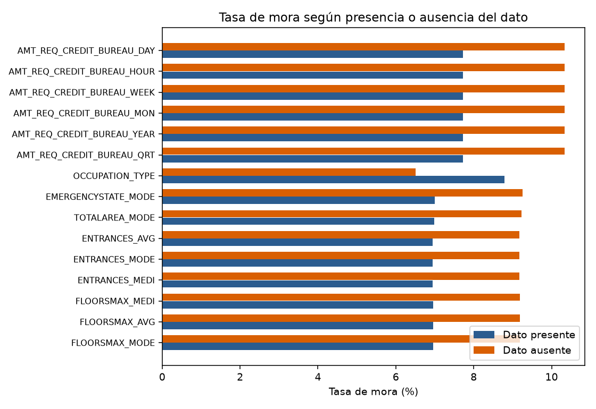
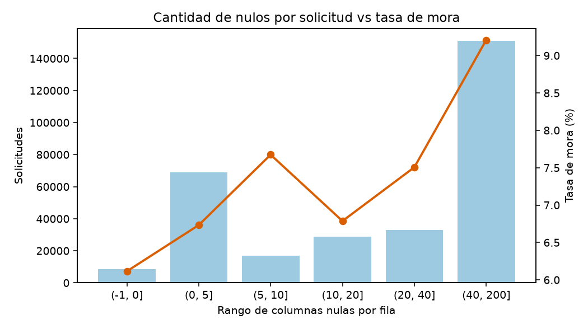
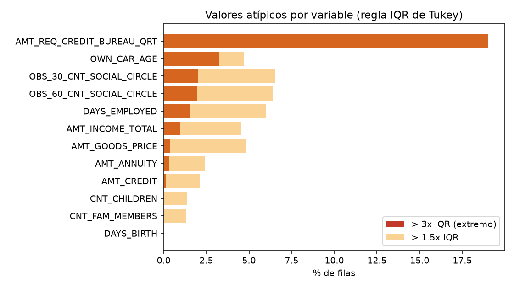
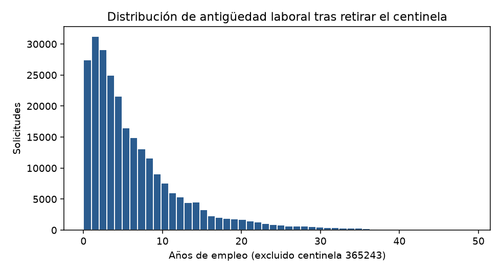
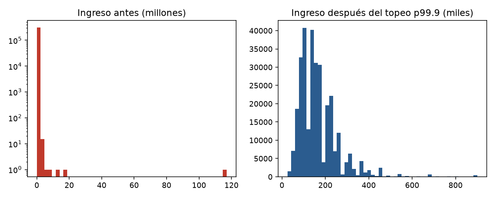

# Fase 3: Preparación de los Datos (CRISP-DM) — Informe Completo

**Universidad Nacional Mayor de San Marcos** · Facultad de Ingeniería de Sistemas e Informática · Escuela Profesional de Ingeniería de Software  
**Asignatura:** Minería de Datos · **Docente:** Pedro Martín Lezama Gonzales · **Grupo 12**  
**Integrantes:** Gabriel Sonny De la Cruz Aguilar · Diego Martin Arevalo Mauricio · Sebastian Joaquin Chicata Serrato · David Sebastian Piñarreta Rojas · Ashley Elizabeth Bayona Vera

---

## 1. Introducción y alcance

La Fase 3 de la metodología CRISP-DM transforma las siete tablas relacionales del ecosistema *Home Credit Default Risk* ($\approx 2.66\text{ GB}$ en disco, $58,441,149$ registros totales) en un conjunto de datos consolidado, limpio, enriquecido mediante ingeniería de características y particionado en entrenamiento y validación bajo estrictos controles contra fuga de datos (*data leakage*).

Siguiendo la política vinculante establecida en la Comprensión del Negocio y el plan de saneamiento de la Fase 2:
1. **No se imputan artificialmente los valores faltantes** con medias ni medianas en las variables de modelado basadas en árboles (`LightGBM` / `XGBoost`), dado que la ausencia de información en vivienda ($48\text{--}70\%$), vehículo ($65.99\%$), puntajes externos (`EXT_SOURCE_1`, $56.38\%$) y tarjeta de crédito ($66.32\%$ sin tarjeta) constituye una **señal informativa de negocio (MNAR/MAR)** capturada mediante banderas binarias (`FALTA_*`, `TIENE_BUREAU`, `TIENE_PREV_APP`, `TIENE_TARJETA`).
2. **No se eliminan filas por valores extremos** para no perder casos de la clase minoritaria (`TARGET = 1`, $24,825$ morosos, $8.0729\%$): los valores centinela se recodifican a `NaN` con su respectiva bandera (`FLAG_NO_EMPLEADO`) y las colas extremas implausibles se acotan al percentil $99.9$ con marca de reversibilidad (`TOPEADO_*`).
3. El informe cubre la totalidad de la Fase 3: **3.1 Selección de los datos**, **3.2 Limpieza de los datos**, **3.3 Construcción de nuevos datos (Ingeniería de características)**, **3.4 Integración y consolidación relacional** y **3.5 Formateo, selección final de variables, auditoría de sesgos y partición estratificada train/validación**.

### Insumos recibidos de la Fase 2

| Insumo | Valor verificado |
| :--- | :--- |
| **Base principal** | `application_train.csv`: $307,511$ solicitudes $\times 122$ columnas; `TARGET` con $8.0729\%$ de mora ($24,825$ casos) |
| **Tablas relacionales** | `bureau` ($1,716,428$), `bureau_balance` ($27,299,925$), `previous_application` ($1,670,214$), `POS_CASH_balance` ($10,001,358$), `installments_payments` ($13,605,401$), `credit_card_balance` ($3,840,312$) |
| **Exclusión por Charter** | `application_test.csv` y `sample_submission.csv` no se utilizan |
| **Hallazgos de calidad tratados** | Centinela `365243` en `DAYS_EMPLOYED` ($18.0072\%$, $55,374$ filas); ingreso máximo de $117,000,000$; código `XNA` en `CODE_GENDER` ($n=4$) y `ORGANIZATION_TYPE` ($n=55,374$); $67$ de $122$ columnas con nulos; `RATE_INTEREST_*` con $99.64\%$ de nulos; diccionario con $38$ columnas vs. $37$ reales en `previous_application` |

---

## 2. Selección de los datos (Rúbrica 3.1)

### 2.1 Tablas incluidas y excluidas

| Tabla | Decisión | Motivo |
| :--- | :--- | :--- |
| `application_train.csv` | **Incluir (base)** | $1\text{ fila} = 1\text{ solicitud}$; contiene `TARGET` y llave única `SK_ID_CURR` ($307,511$ clientes) |
| `application_test.csv` | **Excluir** | Carece de `TARGET` y está fuera del alcance fijado en el *Project Charter* |
| `bureau.csv`, `bureau_balance.csv` | **Incluir con bandera `TIENE_BUREAU`** | Historial crediticio en otros burós; `bureau_balance` se agrega en 2 niveles vía `SK_ID_BUREAU` $\rightarrow$ `SK_ID_CURR` ($263,491$ clientes de `train` con buró, $85.69\%$) |
| `previous_application.csv`, `POS_CASH_balance.csv`, `installments_payments.csv` | **Incluir con bandera `TIENE_PREV_APP`** | Origen de las señales de comportamiento histórico de pago y aprobación/rechazo previo en Home Credit ($\approx 95\%$ de cobertura en `train`) |
| `credit_card_balance.csv` | **Incluir con bandera `TIENE_TARJETA`** | Subpoblación con línea revolvente activa ($33.68\%$ de los clientes de `train`); la ausencia de registros identifica un perfil de producto, no un error |
| `HomeCredit_columns_description.csv` | **Solo referencia** | Diccionario de $219$ filas usado para validación estructural; no entra al modelo |

### 2.2 Filas incluidas y excluidas (`seleccion_tablas.csv`)

* **`application_train.csv`:** Se conservan las **$307,511$ filas completas** ($0$ eliminaciones).
* **Tablas secundarias:** Se filtran estrictamente a los `SK_ID_CURR` presentes en `application_train` (y `bureau_balance` a los `SK_ID_BUREAU` de dichos clientes) para evitar contaminar las agregaciones con registros de `application_test`:

| Tabla secundaria | Filas totales (CSV) | Filas en `train` (incluidas) | Filas fuera de `train` (excluidas) | % conservado en `train` | Columnas |
| :--- | ---: | ---: | ---: | ---: | ---: |
| `bureau` | $1,716,428$ | $1,465,325$ | $251,103$ | $85.3706\%$ | $17$ |
| `bureau_balance` | $27,299,925$ | $14,701,612$ | $12,598,313$ | $53.8522\%$ | $3$ |
| `previous_application` | $1,670,214$ | $1,413,701$ | $256,513$ | $84.6419\%$ | $37$ |
| `POS_CASH_balance` | $10,001,358$ | $8,543,375$ | $1,457,983$ | $85.4221\%$ | $8$ |
| `installments_payments` | $13,605,401$ | $11,591,592$ | $2,013,809$ | $85.1985\%$ | $8$ |
| `credit_card_balance` | $3,840,312$ | $3,227,965$ | $612,347$ | $84.0548\%$ | $23$ |

### 2.3 Columnas incluidas y excluidas (`seleccion_columnas_excluidas.csv`)

Aplicando los dos criterios objetivos parametrizados (**casi constante** $\ge 99.9\%$ del valor dominante en `application_train` y **casi vacía** $\ge 95.0\%$ de nulos en tablas secundarias), se excluyen **12 columnas crudas** (10 de `application_train` y 2 de `previous_application`):

| # | Tabla | Columna excluida | Motivo verificado | Decisión |
| :---: | :--- | :--- | :--- | :---: |
| 1 | `application_train` | `FLAG_MOBIL` | Casi constante (valor dominante $99.9997\%$, solo $1$ caso con valor $0$) | Excluir |
| 2 | `application_train` | `FLAG_DOCUMENT_2` | Casi constante (valor dominante $99.9958\%$) | Excluir |
| 3 | `application_train` | `FLAG_DOCUMENT_4` | Casi constante (valor dominante $99.9919\%$) | Excluir |
| 4 | `application_train` | `FLAG_DOCUMENT_7` | Casi constante (valor dominante $99.9808\%$) | Excluir |
| 5 | `application_train` | `FLAG_DOCUMENT_10` | Casi constante (valor dominante $99.9977\%$) | Excluir |
| 6 | `application_train` | `FLAG_DOCUMENT_12` | Casi constante (valor dominante $99.9993\%$) | Excluir |
| 7 | `application_train` | `FLAG_DOCUMENT_17` | Casi constante (valor dominante $99.9733\%$) | Excluir |
| 8 | `application_train` | `FLAG_DOCUMENT_19` | Casi constante (valor dominante $99.9405\%$) | Excluir |
| 9 | `application_train` | `FLAG_DOCUMENT_20` | Casi constante (valor dominante $99.9493\%$) | Excluir |
| 10 | `application_train` | `FLAG_DOCUMENT_21` | Casi constante (valor dominante $99.9665\%$) | Excluir |
| 11 | `previous_application` | `RATE_INTEREST_PRIMARY` | Casi vacía ($99.64\%$ de nulos) | Excluir |
| 12 | `previous_application` | `RATE_INTEREST_PRIVILEGED` | Casi vacía ($99.64\%$ de nulos) | Excluir |

**Decisión cerrada sobre variables protegidas (`SCRUM-28`):** Las columnas `CODE_GENDER`, `NAME_EDUCATION_TYPE` y `NAME_FAMILY_STATUS` se mantienen en los archivos Parquet con rol `auditoria_sesgos` para ejecutar la auditoría de paridad ($\ge 0.80$) en la Fase 5, pero **se excluyen de la lista final de variables predictoras (`incluir_modelo = False` en `lista_features_final.csv`)** en cumplimiento de la Ley N.° 29733 y la normativa SBS.

---

## 3. Limpieza de los datos (Rúbrica 3.2)

### 3.1 Valores faltantes y creación de banderas (`banderas_ausencia_creadas.csv`)

En `application_train`, **$67$ de las $122$ columnas** presentan valores nulos ($41$ de ellas superan el $50\%$ de nulos). En lugar de imputar, se agruparon las columnas con **patrón de ausencia idéntico en las mismas filas** (`faltantes_bloques_patron_identico.csv`, que identificó $16$ bloques multi-columna exactos) y se crearon **$24$ banderas binarias `FALTA_*`** para todos los bloques con $\ge 5.0\%$ de ausencia:

| # | Bandera creada (`FALTA_*`) | Columnas cubiertas en el bloque | % Ausente |
| :---: | :--- | :---: | ---: |
| 1 | `FALTA_COMMONAREA_AVG` | 3 (`AVG`, `MODE`, `MEDI`) | $69.8723\%$ |
| 2 | `FALTA_NONLIVINGAPARTMENTS_MEDI` | 3 (`AVG`, `MODE`, `MEDI`) | $69.4330\%$ |
| 3 | `FALTA_FONDKAPREMONT_MODE` | 1 | $68.3862\%$ |
| 4 | `FALTA_LIVINGAPARTMENTS_AVG` | 3 (`AVG`, `MODE`, `MEDI`) | $68.3550\%$ |
| 5 | `FALTA_FLOORSMIN_MODE` | 3 (`AVG`, `MODE`, `MEDI`) | $67.8486\%$ |
| 6 | `FALTA_YEARS_BUILD_AVG` | 3 (`AVG`, `MODE`, `MEDI`) | $66.4978\%$ |
| 7 | `FALTA_OWN_CAR_AGE` | 1 | $65.9908\%$ |
| 8 | `FALTA_LANDAREA_MEDI` | 3 (`AVG`, `MODE`, `MEDI`) | $59.3767\%$ |
| 9 | `FALTA_BASEMENTAREA_MODE` | 3 (`AVG`, `MODE`, `MEDI`) | $58.5160\%$ |
| 10 | `FALTA_EXT_SOURCE_1` | 1 | $56.3811\%$ |
| 11 | `FALTA_NONLIVINGAREA_MODE` | 3 (`AVG`, `MODE`, `MEDI`) | $55.1792\%$ |
| 12 | `FALTA_ELEVATORS_AVG` | 3 (`AVG`, `MODE`, `MEDI`) | $53.2960\%$ |
| 13 | `FALTA_WALLSMATERIAL_MODE` | 1 | $50.8408\%$ |
| 14 | `FALTA_APARTMENTS_AVG` | 3 (`AVG`, `MODE`, `MEDI`) | $50.7497\%$ |
| 15 | `FALTA_ENTRANCES_MODE` | 3 (`AVG`, `MODE`, `MEDI`) | $50.3488\%$ |
| 16 | `FALTA_LIVINGAREA_AVG` | 3 (`AVG`, `MODE`, `MEDI`) | $50.1933\%$ |
| 17 | `FALTA_HOUSETYPE_MODE` | 1 | $50.1761\%$ |
| 18 | `FALTA_FLOORSMAX_MODE` | 3 (`AVG`, `MODE`, `MEDI`) | $49.7608\%$ |
| 19 | `FALTA_YEARS_BEGINEXPLUATATION_MODE` | 3 (`AVG`, `MODE`, `MEDI`) | $48.7810\%$ |
| 20 | `FALTA_TOTALAREA_MODE` | 1 | $48.2685\%$ |
| 21 | `FALTA_EMERGENCYSTATE_MODE` | 1 | $47.3983\%$ |
| 22 | `FALTA_OCCUPATION_TYPE` | 1 | $31.3455\%$ |
| 23 | `FALTA_EXT_SOURCE_3` | 1 | $19.8253\%$ |
| 24 | `FALTA_AMT_REQ_CREDIT_BUREAU_HOUR` | 6 (`HOUR`, `DAY`, `WEEK`, `MON`, `QRT`, `YEAR`) | $13.5016\%$ |

### 3.2 Patrón de datos faltantes (`faltantes_vs_target.csv` y `faltantes_por_fila.csv`)

La prueba $\chi^2$ de independencia entre el indicador de ausencia y `TARGET` confirma con $p < 10^{-70}$ que **la ausencia de datos NO es completamente al azar (se descarta MCAR)**:

* **Bloque de consultas a buró (`AMT_REQ_CREDIT_BUREAU_*`, $13.50\%$ de nulos):** Cuando el dato falta, la tasa de mora sube a **$10.337\%$** frente a **$7.719\%$** cuando existe ($\Delta = +2.618\text{ pp}$, $p = 4.92 \times 10^{-74}$). Refleja clientes sin historial consultable en buró.
* **Bloque de vivienda (`EMERGENCYSTATE_MODE`, `TOTALAREA_MODE`, `ENTRANCES_*`, `LIVINGAREA_*`, $47.4\text{--}69.9\%$ de nulos):** Quienes no reportan características de su edificio presentan una tasa de mora de **$9.18\%\text{--}9.26\%$** frente a **$6.95\%\text{--}7.00\%$** cuando el dato está presente ($\Delta \approx +2.25\text{ pp}$, $p < 10^{-113}$).
* **Ocupación (`OCCUPATION_TYPE`, $31.35\%$ de nulos):** Cuando falta, la mora baja a **$6.513\%$** frente a **$8.785\%$** cuando se declara ($\Delta = -2.272\text{ pp}$, $p = 4.80 \times 10^{-102}$), ya que incluye al segmento de pensionistas/jubilados con menor riesgo.
* **Cantidad de nulos por solicitud (`faltantes_por_fila.csv`):** Las solicitudes con $0$ nulos ($8,602$ filas) tienen una mora de **$6.115\%$**, las de $(0, 5]$ nulos ($68,829$ filas) tienen **$6.733\%$**, mientras que las solicitudes con más de $40$ campos vacíos ($151,167$ filas) alcanzan una mora de **$9.208\%$**.

### 3.3 Valores atípicos y topeo al percentil 99.9 (`atipicos_application_train.csv` y `topeo_antes_despues.csv`)

1. **Centinela laboral (`DAYS_EMPLOYED = 365243`):** Presente en **$55,374$ solicitudes ($18.0072\%$)**, de las cuales $55,352$ corresponden a `Pensioner` y $22$ a `Unemployed`. Presenta una tasa de mora de **$5.40\%$** frente a **$8.66\%$** en el resto de solicitantes. Se reemplaza por `NaN` y se activa `FLAG_NO_EMPLEADO = 1`.
2. **Topeo al percentil 99.9 con bandera `TOPEADO_*`:** Aplicado a las 4 variables con colas extremas implausibles:

| Variable acotada | Tope p99.9 | Filas topeadas | Máx. antes | Máx. después | Media antes | Media después | Desv. Est. antes | Desv. Est. después |
| :--- | ---: | ---: | ---: | ---: | ---: | ---: | ---: | ---: |
| `AMT_INCOME_TOTAL` | $900,000.0$ | $278$ | $117,000,000.0$ | $900,000.0$ | $168,797.92$ | $167,771.35$ | $237,123.15$ | $91,928.89$ |
| `OBS_30_CNT_SOCIAL_CIRCLE` | $17.0$ | $222$ | $348.0$ | $17.0$ | $1.42$ | $1.42$ | $2.40$ | $2.30$ |
| `OBS_60_CNT_SOCIAL_CIRCLE` | $16.0$ | $292$ | $344.0$ | $16.0$ | $1.41$ | $1.40$ | $2.38$ | $2.27$ |
| `AMT_REQ_CREDIT_BUREAU_QRT` | $4.0$ | $108$ | $261.0$ | $4.0$ | $0.27$ | $0.26$ | $0.79$ | $0.61$ |

*(Nota: Al acotar los $278$ ingresos mayores a $900,000$, la desviación estándar cae en un $61.2\%$ sin perder ninguna observación).*

### 3.4 Datos duplicados (`duplicados_application_train.csv` y `duplicados_secundarias.csv`)

* **`application_train`:** $0$ filas duplicadas completas y $0$ `SK_ID_CURR` repetidos sobre $307,511$ registros.
* **Tablas secundarias:** **$0$ duplicados de fila completa en las 6 tablas secundarias**. Al evaluar llaves naturales compuestas, `bureau` (`SK_ID_BUREAU`), `bureau_balance` (`SK_ID_BUREAU + MONTHS_BALANCE`), `previous_application` (`SK_ID_PREV`), `POS_CASH_balance` (`SK_ID_PREV + MONTHS_BALANCE`) y `credit_card_balance` (`SK_ID_PREV + MONTHS_BALANCE`) registran **$0$ llaves repetidas**. Únicamente `installments_payments` presenta $653,483$ repeticiones en `SK_ID_PREV + NUM_INSTALMENT_VERSION + NUM_INSTALMENT_NUMBER` ($4.8031\%$) con montos/fechas distintos porque representan **pagos parciales o fraccionados de una misma cuota**, los cuales se conservan y se suman al agregar por cliente.

### 3.5 Errores e inconsistencias (`inconsistencias_application_train.csv` y `diccionario_vs_csv.csv`)

De las 20 reglas de coherencia verificadas sobre `application_train`:
* `CODE_GENDER = XNA`: **$4$ filas ($0.0013\%$)** $\rightarrow$ convertidas a `NaN`.
* `ORGANIZATION_TYPE = XNA`: **$55,374$ filas ($18.0072\%$)** $\rightarrow$ coincide al $100\%$ con el centinela `DAYS_EMPLOYED = 365243` (pensionistas); convertidas a `NaN`.
* `FLAG_OWN_CAR = Y` con `OWN_CAR_AGE` vacío: **$5$ filas ($0.0016\%$)** $\rightarrow$ capturadas por `FALTA_OWN_CAR_AGE = 1`.
* **Todas las demás 15 reglas de incoherencia dieron exactamente $0$ filas afectadas:** `DAYS_BIRTH >= 0` ($0$), `Edad < 18 o > 100 años` ($0$), `DAYS_EMPLOYED positivo != 365243` ($0$), `Años empleado > edad` ($0$), `Inicio laboral < 14 años` ($0$), `CNT_FAM_MEMBERS < CNT_CHILDREN` ($0$), `AMT_INCOME_TOTAL <= 0` ($0$), `AMT_CREDIT <= 0` ($0$), `AMT_ANNUITY > AMT_CREDIT` ($0$), `FLAG_OWN_CAR = N con OWN_CAR_AGE informado` ($0$), `EXT_SOURCE_1/2/3 fuera de [0,1]` ($0$), `DAYS_REGISTRATION > 0` ($0$) y `DAYS_ID_PUBLISH > 0` ($0$).
* **Contraste contra el diccionario (`diccionario_vs_csv.csv`):** `previous_application` declara `NFLAG_MICRO_CASH` en el diccionario ($38$ variables) pero no existe en el CSV real ($37$ columnas); en `bureau` y `bureau_balance` el diccionario nombra `SK_BUREAU_ID` a la llave que en el CSV se llama `SK_ID_BUREAU`.

### 3.6 Optimización de tipos y memoria (`antes_despues_application_train.csv`)

| Momento | Filas | Columnas | Nulos totales | Memoria en RAM |
| :--- | ---: | ---: | ---: | ---: |
| **Antes de limpieza v1** | $307,511$ | $122$ | $9,152,465$ | $529.5\text{ MB}$ (pandas object) / $310.2\text{ MB}$ |
| **Después de limpieza v1 (`application_train_clean.parquet`)** | $307,511$ | $141$ | $9,263,217$ | **$105.28\text{ MB}$** |

*(Se excluyeron $10$ columnas casi constantes, se añadieron $1$ bandera de empleo + $4$ banderas de topeo + $24$ banderas de ausencia = $141$ columnas, reduciendo el peso en RAM en más de un $66\%$).*

---

## 4. Construcción de nuevos datos e Integración Relacional (Rúbricas 3.3 y 3.4)

Mediante los scripts modulares en `03-preparacion-datos/scripts/`, se agregaron las 6 tablas secundarias a nivel de cliente (`SK_ID_CURR`) y se fusionaron con `application_train_clean.parquet`:

1. **`agg_bureau.py` $\rightarrow$ `data/processed/bureau_agg.parquet` ($263,491\text{ clientes} \times 27\text{ columnas}$, $29.90\text{ MB}$):**
   * Agregación en 2 niveles (`bureau_balance` por `SK_ID_BUREAU` $\rightarrow$ `bureau` por `SK_ID_CURR`): conteo de créditos totales, activos, cerrados y *bad debt*, antigüedad media/mín/máx, deuda total vs. límite de crédito (`BUREAU_TOTAL_DEBT_TO_CREDIT`), máximo DPD y meses en mora nivel 1–5 (`BUREAU_BB_DPD_MONTHS_SUM`, `BUREAU_BB_DPD_RATIO_MEAN`).
2. **`agg_previous_pos.py` $\rightarrow$ `data/processed/previous_pos_agg.parquet` ($292,224\text{ clientes} \times 30\text{ columnas}$, $41.25\text{ MB}$):**
   * Limpia el centinela `365243` en las 5 columnas `DAYS_*` de solicitudes previas y calcula tasas de aprobación (`PREV_APPROVAL_RATE`) y rechazo (`PREV_REFUSAL_RATE`), ratio monto solicitado/aprobado (`PREV_APP_CREDIT_RATIO_MEAN`), meses activos en `POS_CASH_balance` y días de atraso (`POS_DPD_MAX`, `POS_DPD_MEAN`, `POS_DPD_MONTHS_RATIO`).
3. **`agg_cards.py` $\rightarrow$ `data/processed/cc_installments_agg.parquet` ($291,874\text{ clientes} \times 31\text{ columnas}$, $46.76\text{ MB}$):**
   * En `installments_payments`: cálculo de atraso por cuota (`INST_DPD`), pago anticipado (`INST_DBD`), proporción de cuotas pagadas tarde (`INST_LATE_RATIO`), proporción de pagos incompletos (`INST_UNDERPAID_RATIO`) y ratio total pagado/exigido (`INST_PAYMENT_TO_INSTALMENT_RATIO`).
   * En `credit_card_balance`: utilización media y máxima de línea de tarjeta (`CC_UTILIZATION_MEAN`, `CC_UTILIZATION_MAX`), disposiciones en cajero (`CC_DRAWINGS_ATM_SUM`) y meses con DPD (`CC_DPD_RATIO`).
4. **`build_dataset.py` $\rightarrow$ `data/processed/dataset_consolidado.parquet` ($307,511\text{ filas} \times 245\text{ columnas}$, $251.92\text{ MB}$ en RAM):**
   * Integra las 3 tablas de agregados sobre `application_train_clean.parquet` manteniendo relación $1:1$ exacta por `SK_ID_CURR` ($307,511$ filas únicas) y construye **19 variables derivadas** documentadas en `diccionario_features_derivadas.csv` y exportadas en `data/processed/features_derivadas.parquet`:
     * **Presencia de subpoblación:** `TIENE_BUREAU`, `TIENE_PREV_APP`, `TIENE_TARJETA`.
     * **Ratios financieros:** `CREDIT_TO_INCOME_RATIO`, `ANNUITY_TO_INCOME_RATIO`, `ANNUITY_TO_CREDIT_RATIO`, `CREDIT_TO_GOODS_RATIO`, `INCOME_PER_FAM_MEMBER`, `TOTAL_DEBT_TO_INCOME_RATIO`.
     * **Demográficas/temporales:** `EDAD_ANIOS`, `ANIOS_EMPLEO`, `EMPLEO_A_EDAD_RATIO`.
     * **Síntesis de scores externos (las de mayor correlación con `TARGET`):** `EXT_SOURCE_MEAN` ($\lvert r \rvert = 0.2221$), `EXT_SOURCE_MAX` ($\lvert r \rvert = 0.1969$), `EXT_SOURCE_PROD` ($\lvert r \rvert = 0.1895$), `EXT_SOURCE_MIN` ($\lvert r \rvert = 0.1853$), `EXT_SOURCE_STD`.
     * **Síntesis de mora histórica:** `HIST_DPD_TOTAL_EVENTS`, `HIST_HAS_ANY_DPD`.

---

## 5. Selección final de variables y Partición Train/Validación (Rúbrica 3.5)

1. **Lista final de variables (`lista_features_final.csv`):**
   * De las $245$ columnas de `dataset_consolidado.parquet`:
     * $2$ son estructurales (`SK_ID_CURR` y `TARGET`).
     * $3$ se reservan exclusivamente para la auditoría de sesgos de la Fase 5 (`CODE_GENDER`, `NAME_EDUCATION_TYPE`, `NAME_FAMILY_STATUS` $\rightarrow$ `incluir_modelo = False`, documentadas en `anexo_auditoria_preliminar.md`).
     * **$240$ variables quedan seleccionadas como predictoras (`incluir_modelo = True`)** para el entrenamiento en la Fase 4.
2. **Partición estratificada anti-leakage (`split_dataset.py` y `checklist_leakage.md`):**
   * División $80\% / 20\%$ estratificada por `TARGET` (`random_state=42`):
     * **`data/processed/train.parquet`:** **$246,008$ solicitudes** ($19,860$ casos de mora $\rightarrow$ **$8.0729\%$**).
     * **`data/processed/val.parquet`:** **$61,503$ solicitudes** ($4,965$ casos de mora $\rightarrow$ **$8.0728\%$**).
     * **Intersección de clientes (`SK_ID_CURR`):** **$0$ clientes compartidos**; los cuantiles de topeo `p99.9` se recalcularon exclusivamente sobre `train.parquet` y se aplicaron a `val.parquet`.

---

## Referencias (IEEE)

[1] Home Credit Group, "Home Credit Default Risk," Kaggle Competition, 2018. [Online]. Available: https://www.kaggle.com/competitions/home-credit-default-risk/overview  
[2] P. Chapman et al., "CRISP-DM 1.0: Step-by-step data mining guide," SPSS Inc., 2000.  
[3] Congreso de la República del Perú, "Ley N.° 29733, Ley de Protección de Datos Personales," *El Peruano*, 2011.  
[4] Grupo 12, "Fase 2: Comprensión de los Datos (CRISP-DM)," Facultad de Ingeniería de Sistemas e Informática, UNMSM, Lima, Perú, oct. 2026.  
[5] G. Ke et al., "LightGBM: A highly efficient gradient boosting decision tree," in *Proc. Adv. Neural Inf. Process. Syst. (NIPS)*, 2017, pp. 3146–3154.  
[6] T. Chen and C. Guestrin, "XGBoost: A scalable tree boosting system," in *Proc. 22nd ACM SIGKDD Int. Conf. Knowl. Discovery Data Mining*, 2016, pp. 785–794.  
[7] R. J. A. Little and D. B. Rubin, *Statistical Analysis with Missing Data*, 3rd ed. Hoboken, NJ, USA: Wiley, 2019.  
[8] J. W. Tukey, *Exploratory Data Analysis*. Reading, MA, USA: Addison-Wesley, 1977.  
[9] S. Kaufman, S. Rosset, C. Perlich, and O. Stitelman, "Leakage in data mining: Formulation, detection, and avoidance," *ACM Trans. Knowl. Discov. Data*, vol. 6, no. 4, pp. 1–21, 2012.  
[10] W. McKinney, "Data structures for statistical computing in Python," in *Proc. 9th Python in Science Conf.*, 2010, pp. 56–61.
