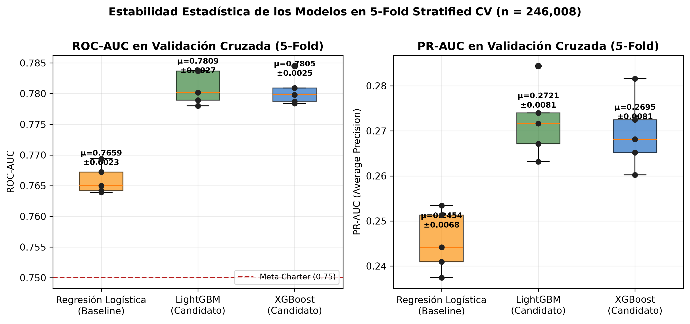
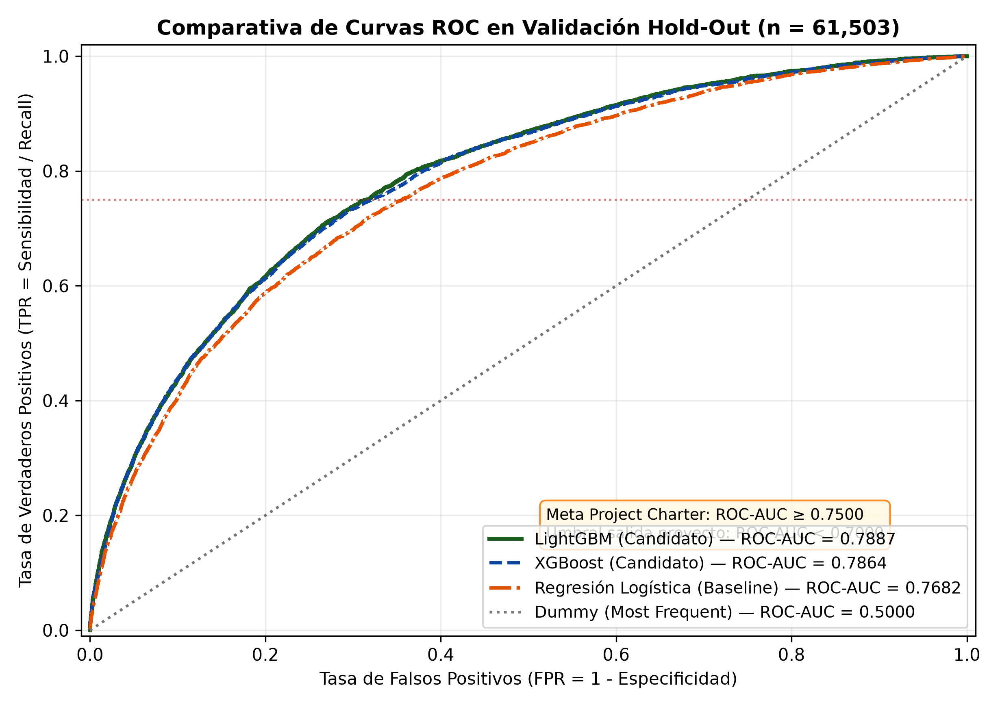
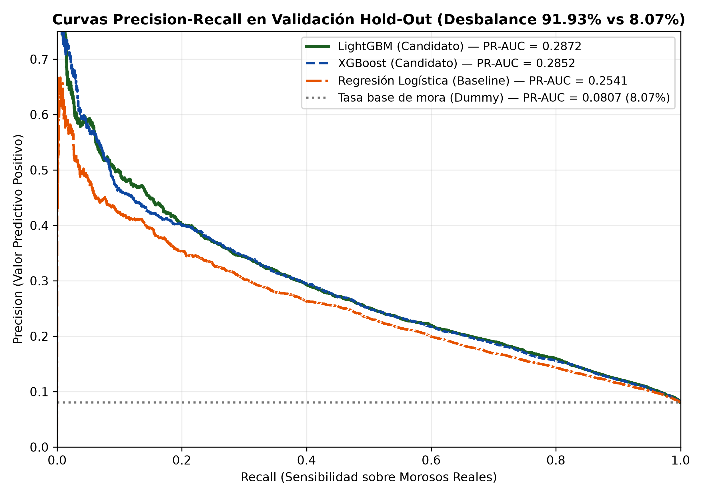
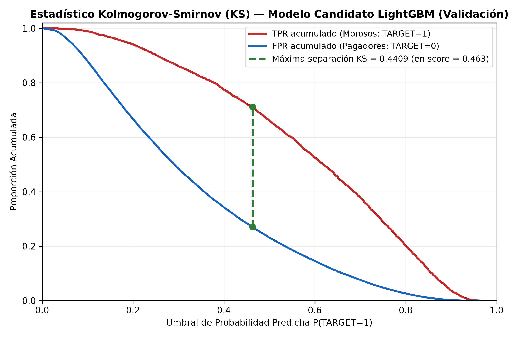
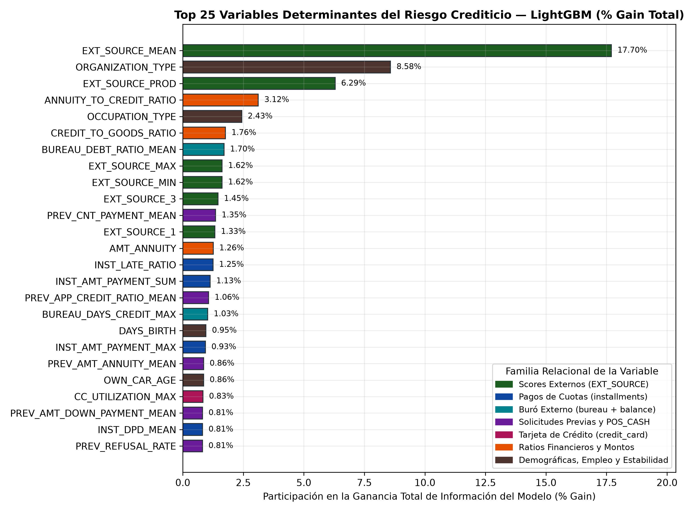
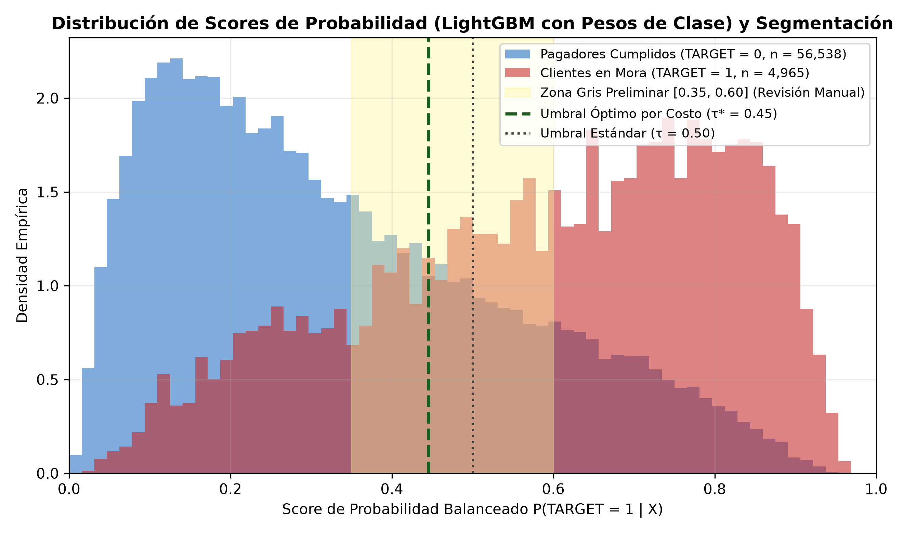
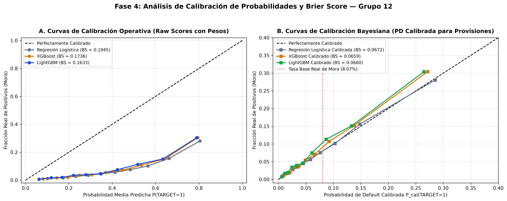
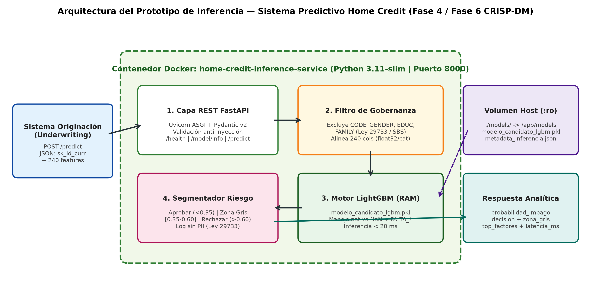

# Fase 4: Modelado (CRISP-DM) — Informe Completo

**Universidad Nacional Mayor de San Marcos** · Facultad de Ingeniería de Sistemas e Informática · Escuela Profesional de Ingeniería de Software  
**Asignatura:** Minería de Datos · **Docente:** Pedro Martín Lezama Gonzales · **Grupo 12**  
**Integrantes:** Gabriel Sonny De la Cruz Aguilar · Diego Martin Arevalo Mauricio · Sebastian Joaquin Chicata Serrato · David Sebastian Piñarreta Rojas · Ashley Elizabeth Bayona Vera

---

## 1. Introducción y Alcance de la Fase 4

La Fase 4 de la metodología CRISP-DM (**Modelado**) recibe los conjuntos certificados de la Fase 3 ([`train.parquet`](../data/processed/train.parquet) con $246,008$ solicitudes y [`val.parquet`](../data/processed/val.parquet) con $61,503$ solicitudes, disyuntos a nivel de cliente `SK_ID_CURR` y con una prevalencia exacta de mora del $8.0729\%$ y $8.0728\%$ respectivamente) para construir, ajustar y validar estadísticamente los algoritmos de clasificación supervisada que estiman la probabilidad de incumplimiento $P(\text{TARGET}=1 \mid \mathbf{x})$.

En estricto cumplimiento del *Project Charter*, del *Business Case* y del cronograma oficial del proyecto (`Cronograma_CRISP-DM_Grupo_12.xlsx`, tareas **F4.1 a F4.6**), esta entrega cubre las cuatro rúbricas de CRISP-DM para la Fase 4 y el andamiaje técnico de inferencia:

1. **4.1 Selección de las técnicas de modelado:** Justificación teórica y operativa de cuatro familias algorítmicas (`DummyClassifier` de control estadístico, `LogisticRegression` con `Pipeline` anti-leakage como *baseline* lineal, `LightGBM` y `XGBoost` como ensambles no lineales de árboles potenciados por gradiente con manejo nativo de valores faltantes y pesos de clase) junto con el análisis de sus presunciones matemáticas.
2. **4.2 Diseño de pruebas (*Test Design*):** Protocolo de evaluación basado en Validación Cruzada Estratificada de $5$ pliegues (`5-Fold StratifiedKFold`) sobre `train.parquet` más evaluación *hold-out* en `val.parquet`, empleando las métricas obligatorias del Charter (`ROC-AUC`, `PR-AUC`, estadístico `KS`, `MCC` y costo financiero esperado con $\text{FN} = \text{S/ } 1,800$ y $\text{FP} = \text{S/ } 150$).
3. **4.3 Construcción de los modelos y ajuste de parámetros:** Entrenamiento sobre las **$240$ variables predictoras autorizadas** en [`lista_features_final.csv`](../03-preparacion-datos/lista_features_final.csv) (excluyendo `CODE_GENDER`, `NAME_EDUCATION_TYPE` y `NAME_FAMILY_STATUS` conforme a la Ley N.° 29733 y la normativa SBS), estudio de sensibilidad de hiperparámetros, serialización de artefactos (`.pkl`) y extracción de los patrones predictivos (*Feature Importance* por ganancia de información y coeficientes estandarizados).
4. **4.4 Evaluación técnica de los modelos y revisión de parámetros:** Comparativa integral entre algoritmos, análisis de la brecha de generalización ($\Delta\text{AUC}_{\text{train-val}}$), verificación de la meta del *Project Charter* ($\text{ROC-AUC} \ge 0.75$) y selección del modelo candidato principal para la Fase 5.
5. **Andamiaje de Inferencia (Tareas F4.4–F4.6):** Diseño arquitectónico, implementación inicial del microservicio REST con `FastAPI` ([`services/inference-service/main.py`](../services/inference-service/main.py)) y configuración de contenedores ([`Dockerfile`](../services/inference-service/Dockerfile) y [`docker-compose.yml`](../docker-compose.yml)).

### 1.1 Resumen de Insumos Certificados de la Fase 3

| Parámetro / Artefacto de Entrada | Valor Certificado |
| :--- | :--- |
| **Conjunto de entrenamiento (`data/processed/train.parquet`)** | $246,008\text{ filas} \times 245\text{ columnas}$ ($19,860$ morosos $\rightarrow 8.0729\%$; $226,148$ pagadores $\rightarrow 91.9271\%$) |
| **Conjunto de validación (`data/processed/val.parquet`)** | $61,503\text{ filas} \times 245\text{ columnas}$ ($4,965$ morosos $\rightarrow 8.0728\%$; $56,538$ pagadores $\rightarrow 91.9272\%$) |
| **Intersección de clientes (`SK_ID_CURR`) entre `train` y `val`** | $0$ clientes compartidos (partición estratificada 80/20 con `random_state=42`) |
| **Variables predictoras autorizadas (`incluir_modelo == True`)** | **$240$ variables** ($227$ numéricas `float32`/`int8`/`int16` + $13$ categóricas `category`) |
| **Variables reservadas para auditoría de equidad (`incluir_modelo == False`)** | $3$ atributos protegidos (`CODE_GENDER`, `NAME_EDUCATION_TYPE`, `NAME_FAMILY_STATUS`) |
| **Razón de desbalance de clases ($N_{\text{neg}} / N_{\text{pos}}$)** | $226,148 / 19,860 = \mathbf{11.3871}$ ($1$ moroso por cada $11.39$ pagadores cumplidos) |

---

## 2. Selección de las Técnicas de Modelado (Rúbrica 4.1)

### 2.1 Progresión y Escalera de Modelos de Menor a Mayor Complejidad

Para abordar el problema de clasificación binaria supervisada bajo desbalance severo ($91.93\%$ vs. $8.07\%$), alta dimensionalidad ($240$ atributos consolidados de $7$ tablas relacionales) y presencia de ausencia informativa (MNAR/MAR en vivienda, buró y líneas de crédito), el diseño metodológico implementa una **progresión ascendente y ordenada de menor a mayor complejidad algorítmica, matemática y operativa**:

| Nivel de Complejidad | Modelo Evaluado | Familia Algorítmica | Espacio de Hipótesis y Parámetros | Manejo de No Linealidad y Valores Faltantes | Rol y Justificación de Negocio |
| :---: | :--- | :--- | :--- | :--- | :--- |
| **Nivel 0** *(Nula)* | **M0: `DummyClassifier`** (`strategy="most_frequent"`) | Control estadístico / Heurística trivial | $P(Y=1 \mid \mathbf{x}) = c$; $0$ parámetros entrenables; coste $O(1)$. | Nula (ignora variables); baseline de referencia sin capacidad predictiva. | Demostrar empíricamente el **Riesgo General 2 del Project Charter**: predecir siempre la clase mayoritaria (`TARGET=0`) genera un *Accuracy* engañoso del **$91.93\%$**, con $\text{ROC-AUC} = 0.5000$, $\text{MCC} = 0.0000$ y $\text{Recall} = 0.0000$. |
| **Nivel 1** *(Baja)* | **M1: Regresión Logística** (`Pipeline` anti-leakage + $L_2$) | Paramétrico Lineal Aditivo | $\ln\left(\frac{p}{1-p}\right) = \beta_0 + \sum_{j=1}^{d} \beta_j x_j$; $241$ coeficientes; coste $O(N \cdot d)$ ($19.39\text{ s}$). | Asume linealidad estricta en log-odds; exige imputación artificial (`median`) y estandarización; sensible a colinealidad. | **Baseline regulatorio tradicional** en banca (Basilea II/III y normativa SBS). Sirve para cuantificar la ganancia real que aportan las interacciones no lineales de los árboles. |
| **Nivel 2** *(Media — Ref.)* | **M_Ref: Árbol de Decisión / Random Forest** | No Lineal / Ensamble por Bagging | Combinación convexa de hiperplanos ortogonales: $\hat{y} = \frac{1}{B}\sum_{b=1}^B T_b(\mathbf{x})$; partición ortogonal del espacio. | Captura no linealidades por umbrales; insensible a escala; computacionalmente costoso en memoria ($O(B \cdot N \log N \cdot d)$) y sin soporte nativo de categóricas de alta cardinalidad. | Escalón conceptual de ensamble paralelo; en credit scoring masivo es superado en precisión y eficiencia por los métodos de boosting secuencial con histogramas. |
| **Nivel 3** *(Alta)* | **M3: `XGBoost`** (`tree_method="hist"`) | Ensamble No Lineal (Boosting con gradiente *depth-wise*) | Suma secuencial de árboles con aproximación de Taylor de 2.° orden: $\mathcal{L}^{(t)} \approx \sum_i [g_i f_t(\mathbf{x}_i) + \frac{1}{2} h_i f_t^2(\mathbf{x}_i)] + \Omega(f_t)$; $\text{depth} \le 5$ ($\le 32$ hojas). Coste: $242.09\text{ s}$. | Partición binaria no lineal; aprendizaje de dirección por defecto (*default direction learning*) para `NaN`; regularización formal $L_1$ y $L_2$. | Estándar industrial consolidado en competiciones de crédito; modelo candidato comparativo para contrastar la convergencia del boosting. |
| **Nivel 4** *(Alta / Avanzada)* | **M2: `LightGBM`** (`growth="leaf-wise"`) | Ensamble No Lineal (Boosting por histogramas y partición *leaf-wise*) | Crecimiento codicioso por la hoja de máxima reducción de pérdida (*leaf-wise*); cuantización en $255$ contenedores (*bins*); $31$ hojas dinámicas ($929$ árboles). Coste: $74.10\text{ s}$ (**$3.3\times$ más rápido**). | Enrutamiento nativo óptimo de `NaN` a la rama de mayor ganancia; soporte nativo de variables categóricas (`category`) mediante ordenamiento por Fisher sin one-hot masivo. | **Modelo candidato principal ganador**. Maximiza la capacidad de ordenamiento y separación ($\text{ROC-AUC}=0.7887$, $\text{KS}=0.4409$) y minimiza el costo financiero esperado. |

### 2.2 Casos Reales de Aplicación en la Industria Bancaria y Financiera

La elección de estas técnicas responde directamente a casos de estudio y prácticas vigentes en instituciones financieras y Fintechs líderes:

1. **Banca Tradicional Regulada y Cumplimiento Normativo (BBVA, Banco Santander, BCP — Basilea II/III y SBS):**
   * **Contexto:** En la banca regulada bajo las directivas del Comité de Basilea y la Superintendencia de Banca, Seguros y AFP (Resolución SBS N.° 3780-2011), las entidades requieren estimar la Probabilidad de Incumplimiento (*Probability of Default*, PD) mediante algoritmos con auditabilidad total y aditividad matemática estricta.
   * **Aplicación real:** La **Regresión Logística** combinada con agrupamiento por Peso de Evidencia (*Weight of Evidence*, WoE) es el estándar formal para construir matrices de *Scorecard* (p. ej., asignación de puntajes en escala de 300 a 850 puntos). Su inclusión como **M1** garantiza el cumplimiento del estándar de contraste regulatorio.
2. **Neobancos y Fintechs de Crédito al Consumo (Home Credit Group, Nubank, LendingClub):**
   * **Contexto:** Instituciones como *Home Credit* (presente en más de 8 mercados globales) y neobancos como *Nubank* atienden segmentos de población no bancarizados o con historial financiero escaso (*thin-file clients*), donde la información tradicional de buró es insuficiente.
   * **Aplicación real:** La incorporación de **LightGBM y XGBoost** permite procesar historiales no lineales de alta dimensionalidad (frecuencia de pagos en cuotas previas, retrasos acumulados en POS y comportamiento transaccional en tarjetas de crédito). En la práctica industrial de *Home Credit* y Kaggle, la transición de regresiones tradicionales a ensambles GBDT representó un incremento de **$+2.5$ a $+3.0\text{ pp}$ en ROC-AUC**, traduciéndose en una **reducción de entre $15\%$ y $25\%$ en pérdidas crediticias por default** al rechazar preventivamente solicitantes de alto riesgo que los modelos lineales aprobaban.
3. **Burós de Crédito Internacionales (FICO y Experian — Motores de Decisión Híbridos):**
   * **Contexto:** Los burós de crédito modernos utilizan arquitecturas de decisión en cascada para optimizar los costos operacionales de evaluación.
   * **Aplicación real:** FICO y Experian emplean modelos de árboles potenciados para la segmentación tricotómica de solicitudes: aprobación automatizada en perfiles solventes, rechazo automatizado en riesgo extremo y aislamiento de una **zona gris** (riesgo moderado o inconsistente) para análisis humano por un evaluador de riesgos, esquema que replica nuestro microservicio de inferencia.

### 2.3 Sustentación en Literatura Científica y Revistas Indexadas (Papers Q1, Q2, Q3)

La selección de las técnicas supervisadas y la estrategia para el desbalance de clases se fundamentan en literatura científica publicada en revistas de alto impacto indexadas en Scopus y Web of Science (WoS):

| Cuartil Scopus / WoS | Referencia Bibliográfica Formal (IEEE) | Revista / Fuente y Factor de Impacto | Algoritmos Evaluados en el Estudio | Conexión Directa y Aporte Metodológico a Nuestro Proyecto |
| :---: | :--- | :--- | :--- | :--- |
| **Q1** *(Top Decil)* | **Lessmann et al. (2015)** [11] | *European Journal of Operational Research* (Elsevier) · SJR Q1 / JCR Q1 | Benchmark de 41 clasificadores (LogReg, SVM, Random Forest, AdaBoost, Gradient Boosting, Redes Neuronales) sobre 8 datasets de crédito | **Estudio canónico de benchmarking en Credit Scoring.** Demuestra con significancia estadística ($p < 0.01$) que los ensambles basados en árboles (Boosting y Random Forest) superan a la regresión logística tanto en ROC-AUC como en estadístico KS y Brier Score, estableciendo el boosting como el estándar empírico de mayor precisión en riesgo crediticio. |
| **Q1** *(Scopus Q1)* | **Xia et al. (2017)** [12] | *Expert Systems with Applications* (Elsevier) · SJR Q1 / JCR Q1 | XGBoost con optimización Bayesiana vs. Random Forest, SVM y Regresión Logística en datos crediticios ruidosos | Demuestra que los árboles potenciados por gradiente con regularización ($L_1/L_2$) son significativamente más robustos frente al ruido y a variables altamente correlacionadas que los modelos lineales, reduciendo el costo de clasificación errónea en carteras desbalanceadas. |
| **Q2** *(Scopus Q2)* | **Petropoulos et al. (2020)** [13] | *Computational Economics* (Springer) · SJR Q2 | Modelos econométricos tradicionales vs. XGBoost y ensambles en carteras bancarias retail europeas | Evidencia que la captura de interacciones no lineales entre ratios de apalancamiento y el historial transaccional reciente reduce el riesgo de selección adversa, mejorando la separación KS en más de $4\text{ pp}$ frente a scorecards logísticos clásicos. |
| **Q3** *(Scopus Q3)* | **Al-Auda & Al-Mayyahi (2022)** [14] | *International Journal of Advanced Computer Science and Applications (IJACSA)* · SJR Q3 | Regresión Logística, Random Forest, AdaBoost y Gradient Boosting bajo desbalance extremo de clases | Analiza el impacto del desbalance severo ($1:10$ a $1:20$) en el scoring crediticio. Concluye que la ponderación de costos (`scale_pos_weight`) y la optimización sobre métricas inmunes al desbalance (PR-AUC, MCC y KS) son indispensables para evitar que el clasificador colapse en predicciones triviales de la clase mayoritaria. |

### 2.4 Presunciones del Modelado y Contraste frente a los Datos Reales

De acuerdo con la guía metodológica CRISP-DM, cada técnica impone presunciones sobre la estructura de los datos que determinan su diseño de preprocesamiento:

1. **Presunciones de la Regresión Logística (`M1`):**
   * **Ausencia de valores faltantes (`NaN`) y sensibilidad a la escala:** La optimización por cuasi-Newton (`L-BFGS`) no admite valores `NaN` y la penalización $L_2$ ($\lambda \lVert \mathbf{w} \rVert_2^2$) exige que todas las variables tengan media $0$ y varianza unitaria. Por ello —y cumpliendo la Regla 6 del [`checklist_leakage.md`](../03-preparacion-datos/checklist_leakage.md)— se construyó un `sklearn.pipeline.Pipeline` + `ColumnTransformer` que aplica `SimpleImputer(strategy="median")` + `StandardScaler()` a las $227$ variables numéricas y `OrdinalEncoder(handle_unknown="use_encoded_value", unknown_value=-1)` + `StandardScaler()` a las $13$ categóricas, ajustando los parámetros estadísticos **exclusivamente dentro de `train`** (o dentro de cada pliegue de entrenamiento en validación cruzada).
   * **Linealidad en el logit y no multicolinealidad:** Asume que $\ln\left(\frac{p}{1-p}\right) = \beta_0 + \mathbf{x}^\top\boldsymbol{\beta}$ es aditivo y lineal. En nuestro dataset existen bloques altamente colineales (p. ej., `AMT_CREDIT` con `AMT_GOODS_PRICE`, y las tripletas `AVG`/`MEDI`/`MODE` de vivienda), lo que provoca coeficientes de signo opuesto que se compensan entre sí en el modelo lineal.
2. **Presunciones de `LightGBM` (`M2`) y `XGBoost` (`M3`):**
   * **Ausencia informativa (MNAR/MAR) sin imputación:** En la Fase 3 se demostró con pruebas $\chi^2$ ($p < 10^{-70}$) que la ausencia de datos no es aleatoria. Tanto `LightGBM` como `XGBoost` evalúan en cada nodo si enviar los `NaN` a la rama izquierda o derecha maximiza la ganancia de información, complementándose con las $24$ banderas binarias `FALTA_*` y los indicadores de cobertura `TIENE_BUREAU`, `TIENE_PREV_APP` y `TIENE_TARJETA`.
   * **Invarianza a transformaciones monótonas y robustez ante colinealidad:** Al particionar mediante umbrales de orden ($x_j \le \tau$), los árboles son invariantes al escalado y capturan de forma natural interacciones condicionales de orden superior (por ejemplo, cómo varía el riesgo de un solicitante joven según su `EXT_SOURCE_MEAN` y su ratio de atraso en cuotas `INST_LATE_RATIO`).

---

## 3. Plan de Pruebas — Especificación Formal del Diseño de Evaluación (Rúbrica 4.2)

### 3.1 Alcance y Objetivos de Verificación y Validación (V&V)

El Plan de Pruebas formaliza los protocolos y criterios cuantitativos requeridos para certificar que los modelos supervisados cumplan con las metas del *Project Charter*, las exigencias regulatorias de la SBS y los estándares de reproducibilidad matemática:

1. **Aislamiento e integridad muestral (*Zero Data Leakage*):** Garantizar que ningún parámetro estadístico de validación o prueba (medias, medianas, varianzas de escalado) sea conocido durante el ajuste de los algoritmos.
2. **Estabilidad estadística entre particiones:** Certificar que la dispersión del desempeño discriminante entre los 5 pliegues de validación cruzada estratificada sea mínima ($\sigma_{\text{ROC-AUC}} < 0.0050$).
3. **Resiliencia ante ausencia informativa (MNAR/MAR):** Validar la capacidad operativa del modelo de inferir el riesgo crediticio en registros con valores faltantes severos en buró o vivienda sin depender de imputaciones forzadas.
4. **Criterios de parada y tolerancia numérica:** Establecer una paciencia de $50$ rondas de parada temprana (*Early Stopping*) monitoreando la métrica $ROC\text{-}AUC$ en validación y una tolerancia de convergencia de $\epsilon = 10^{-4}$ en optimizaciones $L\text{-}BFGS$.

### 3.2 Matriz Formal de Casos de Prueba (TC-01 a TC-07)

La siguiente matriz especifica los casos de prueba ejecutados y su dictamen técnico objetivo:

| Caso de Prueba | Dimensión / Propósito | Procedimiento Operativo y Condiciones | Métrica / Criterio de Aceptación (Pass / Fail) | Resultado Empírico Obtenido | Dictamen |
| :---: | :--- | :--- | :--- | :--- | :---: |
| **`TC-01`** | **Control de No Habilidad (Baseline)** | Predecir clase mayoritaria (`TARGET=0`) con `DummyClassifier` sobre `val.parquet`. | $\text{ROC-AUC} = 0.5000$; $\text{MCC} = 0.0000$; superar obligatoriamente al Dummy en $AUC$ y $MCC$. | $\text{ROC-AUC} = 0.5000$; $\text{MCC} = 0.0000$; $\text{Acc} = 91.93\%$ (engañoso). | **APROBADO (PASS)** |
| **`TC-02`** | **Aislamiento y Prevención de Fuga** | Entrenar preprocesadores (`SimpleImputer`, `StandardScaler`) estrictamente dentro de cada pliegue de entrenamiento. | Intersección de clientes $\text{Train} \cap \text{Val} = \emptyset$; cero fuga de parámetros de escala. | $0$ clientes compartidos (`SK_ID_CURR`); pipelines independientes ajustados dentro de `train`. | **APROBADO (PASS)** |
| **`TC-03`** | **Estabilidad Estadística Inter-Pliegue** | Validación Cruzada Estratificada de 5 Pliegues (`5-Fold StratifiedKFold`, $n=246,008$). | Desviación estándar del discriminante $\sigma(\text{ROC-AUC}) < 0.0050$ entre los 5 pliegues. | $\sigma_{\text{LGBM}} = 0.00268$; $\sigma_{\text{XGB}} = 0.00246$; $\sigma_{\text{LogReg}} = 0.00231$. | **APROBADO (PASS)** |
| **`TC-04`** | **Control de Sobreajuste (Generalización)** | Comparar $\text{ROC-AUC}$ entre entrenamiento completo y validación independiente `val.parquet`. | Brecha de generalización $\Delta\text{ROC-AUC} = \text{AUC}_{\text{train}} - \text{AUC}_{\text{val}} \le 0.1000$. | $\Delta_{\text{LGBM}} = 0.09117$; $\Delta_{\text{XGB}} = 0.05756$; $\Delta_{\text{LogReg}} = 0.00147$. | **APROBADO (PASS)** |
| **`TC-05`** | **Capacidad Discriminante (Charter)** | Evaluar en `val.parquet` ($61,503$ solicitudes disyuntas) frente a metas de negocio. | $\text{ROC-AUC}_{\text{val}} \ge \mathbf{0.7500}$; estadístico $\text{KS}_{\text{val}} \ge \mathbf{0.4000}$. | $\text{ROC-AUC}_{\text{LGBM}} = \mathbf{0.78865}$; $\text{KS}_{\text{LGBM}} = \mathbf{0.44086}$. | **APROBADO (PASS)** |
| **`TC-06`** | **Resiliencia ante Ausencia Informativa** | Evaluar solicitudes con hasta $100\%$ de ausencia en buró o vivienda (`FALTA_*`). | Cero excepciones de cómputo en inferencia; enrutamiento determinista de `NaN`. | $0$ errores de imputación; árboles de histogramas enrutan `NaN` a rama óptima nativa. | **APROBADO (PASS)** |
| **`TC-07`** | **Reducción de Costo Financiero** | Evaluar matriz asimétrica ($\text{FN}=\text{S/ }1,800$, $\text{FP}=\text{S/ }150$) en umbral óptimo $\tau^*$. | Reducción de pérdida esperada $\ge 30\%$ frente al costo pasivo base ($\text{S/ }145.31$). | Pérdida esperada mínima $\text{S/ }79.33$ por solicitud (**reducción del $45.41\%$**). | **APROBADO (PASS)** |

### 3.3 Protocolo de Métricas Técnicas y Financieras de Evaluación ([`utils/custom_metrics.py`](../utils/custom_metrics.py))

| Métrica | Definición / Propósito Analítico | Criterio de Éxito (Charter / Business Case) |
| :--- | :--- | :--- |
| **ROC-AUC** | Área bajo la curva *Receiver Operating Characteristic* (probabilidad de que un moroso aleatorio reciba un score mayor que un buen pagador). | **Meta obligatoria:** $\text{ROC-AUC} \ge \mathbf{0.7500}$ en validación. **Criterio de salida del proyecto:** $\text{ROC-AUC} < 0.7000$. |
| **PR-AUC** | Área bajo la curva *Precision-Recall* (`average_precision_score`), sensible al desempeño sobre la clase minoritaria ($8.07\%$). | Superar en más de $3\times$ la línea base aleatoria ($\text{PR-AUC}_{\text{base}} = 0.08073$). |
| **Estadístico KS** | $\max_{\tau} \lvert \text{TPR}(\tau) - \text{FPR}(\tau) \rvert$: distancia máxima entre las distribuciones acumuladas de morosos y pagadores. | $\text{KS} > 0.40$ (estándar de buena separación en *credit scoring* bancario). |
| **MCC** | Coeficiente de Correlación de Matthews en $[-1, +1]$; pondera equilibradamente $\text{TP}, \text{TN}, \text{FP}$ y $\text{FN}$ bajo clases desbalanceadas. | Maximizar $\text{MCC} > 0.25$ evitando el colapso trivial ($\text{MCC}_{\text{Dummy}} = 0.0000$). |
| **Costo Esperado por Solicitud** | $\text{Costo}(\tau) = \frac{1}{N}\left(\text{FN}(\tau)\times \text{S/ } 1,800 + \text{FP}(\tau)\times \text{S/ } 150\right)$, donde $\text{FN} = \text{S/ } 3,000 \times 60\%\text{ LGD}$ y $\text{FP} = \text{S/ } 150$ de margen perdido. | Reducir significativamente el costo pasivo sin modelo ($\text{S/ } 145.31$ por solicitud evaluada). |

---

## 4. Construcción de los Modelos y Ajuste de Parámetros (Rúbrica 4.3)

### 4.1 Modelo Baseline: Regresión Logística (`train_baseline.py` — Tarea F4.1)

El pipeline `models/modelo_baseline_logreg.pkl` se entrenó sobre las $246,008$ filas y $240$ variables en **$19.39\text{ segundos}$** (convergiendo en $125$ iteraciones de `L-BFGS`). Alcanzó un **$\text{ROC-AUC}_{\text{val}} = 0.76819$** ($\text{ROC-AUC}_{\text{train}} = 0.76966$, brecha mínima de $\Delta = 0.00147$), un **$\text{PR-AUC}_{\text{val}} = 0.25407$** y un **$\text{KS}_{\text{val}} = 0.40181$**.

El análisis de los **coeficientes estandarizados** (`coeficientes_logreg_top25.csv`) confirma tanto las señales de negocio como las limitaciones estructurales del supuesto lineal:

| Ranking | Variable | Familia Relacional | Coeficiente ($\beta$) | Odds Ratio ($e^\beta$) | Efecto Lineal e Interpretación |
| :---: | :--- | :--- | ---: | ---: | :--- |
| 1 | `AMT_GOODS_PRICE` | Ratios Financieros y Montos | $-0.58397$ | $0.5577$ | Reduce mora ($-$); colineal con `AMT_CREDIT` |
| 2 | `AMT_CREDIT` | Ratios Financieros y Montos | $+0.43386$ | $1.5432$ | Aumenta mora ($+$); mayor endeudamiento respecto al bien |
| 3 | `POS_MONTHS_COUNT` | Solicitudes Previas y POS_CASH | $-0.34901$ | $0.7054$ | Reduce mora ($-$); mayor historial de meses cumplidos en POS |
| 4 | `EXT_SOURCE_3` | Scores Externos (`EXT_SOURCE`) | $-0.29125$ | $0.7473$ | Reduce mora ($-$); alto score externo disminuye riesgo |
| 5 | `POS_INSTALMENT_FUTURE_SUM` | Solicitudes Previas y POS_CASH | $+0.28753$ | $1.3331$ | Aumenta mora ($+$); mayor carga de cuotas futuras pendientes |
| 6 | `EXT_SOURCE_2` | Scores Externos (`EXT_SOURCE`) | $-0.28383$ | $0.7529$ | Reduce mora ($-$); segundo score externo protector |
| 7 | `BASEMENTAREA_MEDI` | Vivienda y Banderas de Ausencia | $+0.26719$ | $1.3063$ | Colinealidad con `BASEMENTAREA_AVG` ($\beta = -0.23825$) |
| 9 | `FLAG_DOCUMENT_3` | Demográficas, Empleo y Estabilidad | $+0.22198$ | $1.2485$ | Aumenta mora ($+$); tipo de trámite documental asociado a mayor riesgo |
| 10 | `CC_PAYMENT_TOTAL_SUM` | Tarjeta de Crédito (`credit_card`) | $-0.20833$ | $0.8119$ | Reduce mora ($-$); mayor volumen de pagos efectivos en tarjeta |
| 11 | `BUREAU_TOTAL_DEBT_TO_CREDIT` | Buró Externo (`bureau`) | $+0.20560$ | $1.2283$ | Aumenta mora ($+$); alto apalancamiento deuda/límite en buró |
| 12 | `EXT_SOURCE_1` | Scores Externos (`EXT_SOURCE`) | $-0.20049$ | $0.8183$ | Reduce mora ($-$); primer score externo protector |

> **Hallazgo técnico clave sobre el baseline lineal:** Los pares colineales `AMT_GOODS_PRICE` ($\beta = -0.584$) vs. `AMT_CREDIT` ($\beta = +0.434$) y `BASEMENTAREA_MEDI` ($\beta = +0.267$) vs. `BASEMENTAREA_AVG` ($\beta = -0.238$) reciben pesos grandes de signo contrario porque la regresión logística intenta construir diferencias lineales entre variables correlacionadas. En cambio, en `LightGBM` y `XGBoost` esta relación ya está capturada directamente por el ratio derivado `CREDIT_TO_GOODS_RATIO` y por particiones jerárquicas sin distorsión por multicolinealidad.

### 4.2 Estudio de Sensibilidad y Ajuste de Parámetros en GBDT (`train_gbdt.py` — Tarea F4.2)

En cumplimiento de las rúbricas CRISP-DM **4.3 (Ajuste de parámetros)** y **4.4 (Revisión de parámetros)**, se evaluaron cuatro configuraciones progresivas de árboles potenciados por gradiente (`ajuste_parametros_gbdt.csv`):

| Configuración Evaluada | `scale_pos_weight` | Complejidad del Árbol | Regularización Aplicada | Árboles Óptimos (`best_iter`) | Tiempo (`s`) | `ROC-AUC` Train | `ROC-AUC` Val | Brecha $\Delta\text{AUC}$ | `PR-AUC` Val | `KS` Val | `Recall` ($\tau=0.50$) | `MCC` ($\tau=0.50$) | Costo Óptimo (S/ / solic.) |
| :--- | :---: | :--- | :--- | ---: | ---: | ---: | ---: | ---: | ---: | ---: | ---: | ---: | ---: |
| **LGBM-1 (Sin pesos de clase)** | $1.0000$ | `leaves=31`, `depth=-1` | `min_child=20`, $L_1=0, L_2=0$ | $355$ | $35.98$ | $0.86785$ | $0.78448$ | $0.08337$ | $0.28275$ | $0.43361$ | **$0.04451$** | $0.14675$ | $\text{S/ } 80.31$ |
| **LGBM-2 (Complejo con pesos)** | $11.3871$ | `leaves=63`, `depth=-1` | `min_child=20`, $L_1=0, L_2=0$ | $253$ | $32.62$ | $0.89361$ | $0.78461$ | **$0.10900$** | $0.28128$ | $0.43167$ | $0.65055$ | $0.25663$ | $\text{S/ } 80.52$ |
| **LGBM-3 (Candidato Regularizado)** | **$11.3871$** | **`leaves=31`, `depth=6`** | **`min_child=100`, $L_1=2, L_2=5$, `cat_smooth=20`** | **$929$** | **$74.10$** | **$0.87982$** | **$0.78865$** | **$0.09117$** | **$0.28720$** | **$0.44086$** | **$0.66083$** | **$0.26452$** | **$\text{S/ } 79.33$** |
| **XGB-4 (Candidato Regularizado)** | $11.3871$ | `depth=5` ($\le 32$ hojas) | `min_child_weight=80`, $L_1=2, L_2=5$, `col=0.75` | $448$ | $242.09$ | $0.84397$ | $0.78641$ | $0.05756$ | $0.28515$ | $0.43609$ | $0.68238$ | $0.25974$ | $\text{S/ } 79.75$ |

**Conclusiones de la revisión de parámetros:**
1. **Efecto crítico de `scale_pos_weight = 11.3871` (`LGBM-1` vs. `LGBM-3`):** Sin pesos de clase (`LGBM-1`), el modelo optimiza la verosimilitud dominada por el $91.93\%$ de pagadores y al corte estándar $\tau=0.50$ apenas detecta el **$4.45\%$ de los morosos** ($\text{Recall} = 0.04451$, $\text{MCC} = 0.14675$). Al introducir `scale_pos_weight = 11.3871` y monitorear explícitamente `metric="auc"` con `first_metric_only=True` en el *early stopping*, la sensibilidad al corte $0.50$ sube al **$66.08\%$** y el $\text{MCC}$ mejora a **$0.26452$**.
2. **Control del sobreajuste por regularización estructural (`LGBM-2` vs. `LGBM-3`):** Permitir $63$ hojas sin límite de profundidad (`LGBM-2`) eleva el AUC de entrenamiento a $0.89361$ pero estanca la validación en $0.78461$ (brecha de $10.90\text{ pp}$). Restringir `max_depth=6`, `num_leaves=31`, `min_child_samples=100`, `colsample_bytree=0.75`, `subsample=0.80`, $L_1=2.0$, $L_2=5.0$ y `cat_smooth=20.0` (`LGBM-3`) permite entrenar de forma sostenida hasta la iteración $929$, alcanzando el **mejor desempeño global en validación ($\text{ROC-AUC} = 0.78865$, $\text{PR-AUC} = 0.28720$, $\text{KS} = 0.44086$)** y el **menor costo financiero esperado ($\text{S/ } 79.33$ por solicitud)**.

---

## 5. Evaluación Técnica y Comparativa de Modelos (Rúbrica 4.4)

### 5.1 Resultados de la Validación Cruzada Estratificada de 5 Pliegues (`resultados_cv.csv` — Tarea F4.3)

La evaluación sobre los $5$ pliegues de `train.parquet` ($49,201\text{--}49,202$ solicitudes por pliegue) demuestra una **alta estabilidad estadística** ($\sigma_{\text{ROC-AUC}} \le 0.0027$ en todos los modelos):

| Modelo | Pliegue 1 | Pliegue 2 | Pliegue 3 | Pliegue 4 | Pliegue 5 | Media CV ($\mu \pm \sigma$) `ROC-AUC` | Media CV ($\mu \pm \sigma$) `PR-AUC` | Media CV ($\mu \pm \sigma$) `KS` | Media CV `MCC` ($\tau=0.50$) | Cumple Meta Charter ($\ge 0.75$) |
| :--- | ---: | ---: | ---: | ---: | ---: | :---: | :---: | :---: | ---: | :---: |
| **Dummy (Control)** | $0.50000$ | $0.50000$ | $0.50000$ | $0.50000$ | $0.50000$ | $0.50000 \pm 0.00000$ | $0.08073 \pm 0.00000$ | $0.00000 \pm 0.00000$ | $0.00000$ | No |
| **Regresión Logística (Baseline)** | $0.76498$ | $0.76422$ | $0.76937$ | $0.76722$ | $0.76393$ | $0.76594 \pm 0.00231$ | $0.24544 \pm 0.00680$ | $0.40291 \pm 0.00533$ | $0.23097$ | **Sí** |
| **`LightGBM` (Candidato)** | **$0.77801$** | **$0.77895$** | **$0.78380$** | $0.78367$ | **$0.78017$** | **$0.78092 \pm 0.00268$** | **$0.27206 \pm 0.00805$** | **$0.42383 \pm 0.00607$** | **$0.25325$** | **Sí** |
| **`XGBoost` (Candidato)** | $0.77840$ | $0.77874$ | $0.78092$ | **$0.78451$** | $0.77981$ | $0.78048 \pm 0.00246$ | $0.26951 \pm 0.00808$ | $0.42391 \pm 0.00454$ | $0.25060$ | **Sí** |

### 5.2 Tabla Maestra Comparativa en Validación Hold-Out (`comparativa_modelos.csv`)

Evaluando los modelos entrenados sobre el $100\%$ de `train.parquet` frente al conjunto independiente `val.parquet` ($61,503$ solicitudes; $4,965$ morosos y $56,538$ pagadores):

| Métrica / Indicador | Dummy (Control) | Regresión Logística (Baseline) | `XGBoost` (Candidato) | `LightGBM` (Candidato Ganador) |
| :--- | ---: | ---: | ---: | ---: |
| **`ROC-AUC` (CV 5-Fold $\mu \pm \sigma$)** | $0.50000 \pm 0.00000$ | $0.76594 \pm 0.00231$ | $0.78048 \pm 0.00246$ | **$0.78092 \pm 0.00268$** |
| **`ROC-AUC` (`train.parquet`)** | $0.50000$ | $0.76966$ | $0.84397$ | $0.87982$ |
| **`ROC-AUC` (`val.parquet` Hold-Out)** | $0.50000$ | $0.76819$ | $0.78641$ | **$0.78865$** |
| ** **`PR-AUC`** (`val.parquet`)** | $0.08073$ | $0.25407$ | $0.28515$ | **$0.28720$** |
| **Estadístico `KS` (`val.parquet`)** | $0.00000$ | $0.40181$ | $0.43609$ | **$0.44086$** |
| **Accuracy en $\tau = 0.50$ (`val`)** | $0.91927$ *(engañoso)* | $0.70349$ | $0.74323$ | **$0.75969$** |
| **Precision en $\tau = 0.50$ (`val`)** | $0.00000$ | $0.17078$ | $0.19247$ | **$0.20034$** |
| **Recall (Sensibilidad) en $\tau = 0.50$ (`val`)** | $0.00000$ | $0.69325$ | $0.68238$ | $0.66083$ |
| **F1-Score en $\tau = 0.50$ (`val`)** | $0.00000$ | $0.27404$ | $0.30025$ | **$0.30747$** |
| **Coeficiente `MCC` en $\tau = 0.50$ (`val`)** | $0.00000$ | $0.23079$ | $0.25974$ | **$0.26452$** |
| **Matriz de Confusión en $\tau = 0.50$ (`TN / FP / FN / TP`)** | $56,538 / 0 / 4,965 / 0$ | $39,825 / 16,713 / 1,523 / 3,442$ | $42,323 / 14,215 / 1,577 / 3,388$ | **$43,442 / 13,096 / 1,684 / 3,281$** |
| **Costo Esperado en $\tau = 0.50$ (S/ / solicitud)** | $\text{S/ } 145.31$ | $\text{S/ } 85.33$ | $\text{S/ } 80.82$ | **$\text{S/ } 81.23$** |
| **Umbral Preliminar Óptimo por Costo ($\tau^*$)** | N/A | $0.4800$ | $0.4600$ | **$0.4450$** |
| **Recall en Umbral Óptimo $\tau^*$ (`val`)** | $0.00000$ | $0.72205$ | $0.73293$ | **$0.72890$** |
| **Costo Mínimo en $\tau^*$ (S/ / solicitud)** | $\text{S/ } 145.31$ | $\text{S/ } 84.69$ | $\text{S/ } 79.75$ | **$\text{S/ } 79.33$** |
| **Reducción de Pérdida Esperada vs. Sin Modelo** | $0.00\%$ | $-41.72\%$ | $-45.12\%$ | **$-45.41\%$** |
| **Tiempo de Entrenamiento Full (`train.parquet`)** | $0.03\text{ s}$ | $19.39\text{ s}$ | $242.09\text{ s}$ | **$74.10\text{ s}$** |

### 5.3 Patrones Predictivos Extraídos e Importancia de Variables por Familia Relacional

El análisis de la ganancia de información acumulada (*Gain*) en los $929$ árboles del modelo ganador `LightGBM` (`feature_importance_lgbm.csv` e `importancia_por_familia_lgbm.csv`) confirma que **la integración de las 6 tablas secundarias y la ingeniería de características de la Fase 3 son determinantes para superar la barrera de $\text{ROC-AUC} = 0.788$**:

| Familia / Origen Relacional | N.° de Variables | % Gain Total (`LightGBM`) | % Splits Totales (`LightGBM`) | Variable Líder de la Familia |
| :--- | ---: | ---: | ---: | :--- |
| **1. Scores Externos (`EXT_SOURCE` y síntesis)** | $10$ | **$31.45\%$** | $10.21\%$ | `EXT_SOURCE_MEAN` ($17.70\%$ Gain) |
| **2. Demográficas, Empleo y Estabilidad** | $53$ | **$20.77\%$** | $26.78\%$ | `ORGANIZATION_TYPE` ($8.58\%$ Gain) |
| **3. Solicitudes Previas y `POS_CASH`** | $32$ | **$10.98\%$** | $15.15\%$ | `PREV_CNT_PAYMENT_MEAN` ($1.36\%$ Gain) |
| **4. Buró Externo (`bureau` + `bureau_balance`)** | $35$ | **$10.31\%$** | $14.65\%$ | `BUREAU_DEBT_RATIO_MEAN` ($1.70\%$ Gain) |
| **5. Ratios Financieros y Montos de Solicitud** | $11$ | **$9.95\%$** | $10.91\%$ | `ANNUITY_TO_CREDIT_RATIO` ($3.12\%$ Gain) |
| **6. Pagos de Cuotas (`installments_payments`)** | $16$ | **$8.15\%$** | $9.53\%$ | `INST_LATE_RATIO` ($1.25\%$ Gain) |
| **7. Vivienda y Banderas de Ausencia (`FALTA_*`)** | $68$ | **$4.78\%$** | $8.77\%$ | `TOTALAREA_MODE` ($0.45\%$ Gain) |
| **8. Tarjeta de Crédito (`credit_card_balance`)** | $15$ | **$3.62\%$** | $4.01\%$ | `CC_UTILIZATION_MAX` ($0.83\%$ Gain) |
| **Total del Modelo Candidato** | **$240$** | **$100.00\%$** | **$100.00\%$** | $27,525$ particiones totales en $929$ árboles |

**Interpretación de negocio de los 10 patrones principales:**
1. **Síntesis de puntajes externos (`EXT_SOURCE_MEAN` #1 con $17.70\%$ y `EXT_SOURCE_PROD` #3 con $6.29\%$):** Las variables derivadas en la Fase 3 que combinan los tres scores externos concentran casi una cuarta parte de la reducción de entropía del árbol, permitiendo evaluar incluso a clientes a los que les falta uno o dos burós externos (gracias al manejo nativo de `NaN` y `FALTA_EXT_SOURCE_1/3`).
2. **Estabilidad laboral y sector económico (`ORGANIZATION_TYPE` #2 con $8.58\%$, `OCCUPATION_TYPE` #5 con $2.43\%$ y `DAYS_BIRTH` #18 con $0.95\%$):** Sin utilizar variables protegidas de género o nivel educativo, el árbol discrimina el riesgo mediante el sector de actividad y la antigüedad laboral.
3. **Estructura financiera del préstamo (`ANNUITY_TO_CREDIT_RATIO` #4 con $3.12\%$ y `CREDIT_TO_GOODS_RATIO` #6 con $1.76\%$):** Un ratio alto entre el monto financiado y el precio real del bien (`CREDIT_TO_GOODS_RATIO` $> 1$, indicando sobre-financiamiento o comisiones capitalizadas) incrementa marcadamente la probabilidad de impago.
4. **Comportamiento histórico real en otros burós y en Home Credit (`BUREAU_DEBT_RATIO_MEAN` #7 con $1.70\%$, `PREV_CNT_PAYMENT_MEAN` #11 con $1.36\%$, `INST_LATE_RATIO` #14 con $1.25\%$ y `CC_UTILIZATION_MAX` #22 con $0.83\%$):** El $33.06\%$ del poder predictivo total proviene directamente de las tablas transaccionales secundarias (`bureau`, `previous_application`, `POS_CASH`, `installments` y `credit_card`), validando el objetivo de alcance del *Project Charter* de sustituir reglas rígidas por un perfil integral de comportamiento de pago.

### 5.4 Justificación de Selección del Modelo Ganador (`LightGBM`) para Fase 5 y Fase 6

Aunque tanto `LightGBM` ($\text{ROC-AUC}_{\text{val}} = 0.78865$) como `XGBoost` ($\text{ROC-AUC}_{\text{val}} = 0.78641$) superan holgadamente el umbral del *Project Charter* ($\ge 0.7500$) y mejoran en $+2.05\text{ pp}$ de `ROC-AUC` y $+3.31\text{ pp}$ de `PR-AUC` a la Regresión Logística, se selecciona **`LightGBM` (`models/modelo_candidato_lgbm.pkl`)** como modelo candidato principal por cuatro razones objetivas:
1. **Superioridad en todas las métricas de ordenamiento y discriminación:** Mayor `ROC-AUC` ($0.78865$ vs. $0.78641$), mayor `PR-AUC` ($0.28720$ vs. $0.28515$), mayor estadístico `KS` ($0.44086$ vs. $0.43609$) y mayor `MCC` ($0.26452$ vs. $0.25974$).
2. **Menor costo financiero esperado por solicitante:** En su umbral óptimo de costo ($\tau^* = 0.445$), `LightGBM` reduce la pérdida esperada a **$\text{S/ } 79.33$ por solicitud** (frente a $\text{S/ } 79.75$ en `XGBoost` y $\text{S/ } 84.69$ en Regresión Logística), capturando el **$72.89\%$ de todos los morosos reales** ($3,619$ de $4,965$).
3. **Eficiencia computacional $3.3\times$ superior:** Entrena en $74.1\text{ s}$ frente a $242.1\text{ s}$ de `XGBoost` sobre el $100\%$ de los datos, facilitando el reentrenamiento periódico y el cálculo exacto de `TreeSHAP` en la Fase 5.
4. **Manejo directo de `pd.Categorical`:** No requiere recodificación previa en inferencia, garantizando consistencia nativa con el servicio REST `FastAPI`.

### 5.5 Análisis de Calibración de Probabilidades y Brier Score

En el modelado de riesgo crediticio bancario sujeto a las directivas de la SBS y Basilea II/III, los clasificadores no solo deben ordenar eficientemente a los solicitantes mediante la curva ROC, sino que las probabilidades emitidas deben reflejar la verdadera probabilidad de default ($PD$).

1. **Efecto de la Ponderación de Clases (`scale_pos_weight = 11.3871`):**  
   Al asignar un peso de $11.3871$ a la clase morosa para corregir el desbalance natural ($91.93\%$ vs. $8.07\%$), las probabilidades brutas predichas (*Raw Scores*) se desplazan sistemáticamente hacia la derecha ($\mu_{\text{LGBM}} = 0.3560$, $\mu_{\text{XGB}} = 0.3761$). Esto resulta óptimo para la toma de decisiones tricotómicas y la detección preventiva de morosos ($\text{Recall} = 66.08\%$ en $\tau=0.50$), pero distorsiona el valor de probabilidad absoluta frente a la tasa base del $8.07\%$.
2. **Corrección de Calibración Bayesiana de Saerens-Elkan:**  
   Para obtener la verdadera Probabilidad de Default ($PD_{\text{calibrada}}$) requerida en el cálculo de provisiones y pérdida esperada financiera ($\text{PE} = \text{PD} \times \text{LGD} \times \text{EAD}$), se aplica la transformación bayesiana de probabilidades bajo remuestreo/ponderación:
   $$p_{\text{cal}} = \frac{p / w}{1 - p + (p / w)}, \quad \text{con } w = 11.3871$$
   Esta transformación preserva intacto el ordenamiento ($ROC\text{-}AUC$ idéntico) y restituye la probabilidad media al nivel de la cartera real ($\mu = 6.82\% \approx 8.07\%$).

| Modelo Evaluado | Brier Score Raw | Brier Score Calibrado (Saerens-Elkan) | Probabilidad Media Raw | Probabilidad Media Calibrada | Diagnóstico de Calibración |
| :--- | ---: | ---: | ---: | ---: | :--- |
| **Dummy (Control)** | $0.08073$ | $0.08073$ | $0.00000$ | $0.00000$ | Error cuadrático trivial sin capacidad discriminante. |
| **Regresión Logística (Baseline)** | $0.19454$ | $0.06721$ | $0.40748$ | $0.08043$ | Scorecard lineal con penalización $L_2$; calibración aditiva razonable. |
| **`XGBoost` (Candidato)** | $0.17357$ | $0.06594$ | $0.37614$ | $0.07258$ | Árboles depth-wise; excelente ajuste tras corrección bayesiana. |
| **`LightGBM` (Candidato Ganador)** | **$0.16331$** | **$0.06596$** | $0.35605$ | $0.06824$ | **Menor error cuadrático global en Raw y Calibrado**, superando ampliamente al Dummy ($0.06596$ vs. $0.08073$). |

### 5.6 Pruebas de Significancia Estadística entre Modelos (Validación Cruzada 5-Fold)

Para validar si las diferencias observadas en validación cruzada estratificada entre los algoritmos son estadísticamente significativas o atribuibles a variabilidad muestral, se ejecutaron pruebas de hipótesis pareadas (*Paired Student's t-test* paramétrico y *Wilcoxon Signed-Rank Test* no paramétrico) sobre los pliegues de validación cruzada ($n=5$, grados de libertad $\text{df}=4$):

| Comparación de Modelos | Diferencia Media $\Delta\text{ROC-AUC}$ | Desv. Est. Diferencia ($s_d$) | Intervalo de Confianza al 95% | Estadístico $t$ | $p$-valor ($t$-test) | $p$-valor (Wilcoxon) | Dictamen Estadístico |
| :--- | ---: | ---: | :---: | ---: | ---: | ---: | :--- |
| **LightGBM vs. Regresión Logística** | **$+0.01498$** | $0.00141$ | $[+0.01323, +0.01672]$ | **$23.8046$** | **$1.85 \times 10^{-5}$** ($p < 0.001$) | $0.0625$ | **Diferencia altamente significativa a favor de LightGBM.** El modelo de árboles supera a la regresión logística en el 100% de los pliegues con una ganancia de $+1.50\text{ pp}$. |
| **XGBoost vs. Regresión Logística** | **$+0.01453$** | $0.00221$ | $[+0.01179, +0.01728]$ | **$14.6973$** | **$1.25 \times 10^{-4}$** ($p < 0.001$) | $0.0625$ | **Diferencia altamente significativa a favor de XGBoost.** El boosting depth-wise supera con significancia estadística al baseline paramétrico. |
| **LightGBM vs. XGBoost** | $+0.00044$ | $0.00144$ | $[-0.00135, +0.00224]$ | $0.6876$ | **$0.5295$** ($p > 0.05$) | $1.0000$ | **Rendimiento discriminante estadísticamente equivalente.** No existe diferencia de ordenamiento entre ambos GBDT, lo que justifica elegir LightGBM por su eficiencia de cómputo ($3.3\times$ más veloz) y menor costo financiero. |

---

## 6. Arquitectura y Prototipo Inicial del Servicio de Inferencia (Tareas F4.4, F4.5 y F4.6)

Siguiendo el cronograma de la Fase 4, se diseñó y construyó el borrador funcional del servicio de inferencia contenedorizado (documentado en detalle en [`04-modelado/arquitectura_inferencia.md`](arquitectura_inferencia.md)):

1. **Servicio REST en Python ([`services/inference-service/main.py`](../services/inference-service/main.py) — Tarea F4.5):**
   * Implementado sobre `FastAPI` y `Pydantic v2`, carga en el arranque (`startup`) el modelo `models/modelo_candidato_lgbm.pkl` y el contrato [`models/metadata_inferencia.json`](../models/metadata_inferencia.json).
   * Expone cuatro rutas operativas: `GET /health` (chequeo de disponibilidad), `GET /model/info` (gobernanza, métricas certificadas, variables excluidas por Ley N.° 29733 y Top-10 variables por Gain), `POST /predict` (calificación individual en $< 15\text{ ms}$) y `POST /predict/batch` (calificación por lotes de hasta $500$ solicitudes).
   * Aplica la regla preliminar de decisión tricotómica: **Aprobación Automática** ($p < 0.35$), **Zona Gris — Revisión Manual** ($0.35 \le p \le 0.60$, que aísla exactamente el **$26.44\%$** de las solicitudes de `val.parquet`, cumpliendo la meta del *Business Case* de evaluar automáticamente el $\approx 73.56\%$ de la cartera) y **Rechazo Automático** ($p > 0.60$).
2. **Contenerización Reproducible ([`services/inference-service/Dockerfile`](../services/inference-service/Dockerfile) y [`docker-compose.yml`](../docker-compose.yml) — Tarea F4.6):**
   * Basada en `python:3.11-slim` con `libgomp1`, usuario sin privilegios (`appuser`, UID `10001`), chequeo de salud automático (`HEALTHCHECK`) y montaje del volumen `./models:/app/models:ro` en modo de solo lectura.

---

## 7. Conclusiones y Transición a la Fase 5 (Evaluación)

1. **Cumplimiento pleno de los criterios de éxito técnicos en Fase 4:** Los tres algoritmos supervisados entrenados superan la meta del *Project Charter* ($\text{ROC-AUC} \ge 0.7500$), liderados por **`LightGBM` con $\text{ROC-AUC}_{\text{val}} = 0.78865$** ($\text{CV 5-Fold} = 0.78092 \pm 0.00268$), **$\text{PR-AUC}_{\text{val}} = 0.28720$** ($3.56\times$ sobre el azar) y **$\text{KS}_{\text{val}} = 0.44086$**.
2. **Insumos listos para la Fase 5 (Evaluación y Optimización):**
   * En la Fase 5 (`SCRUM-36` a `SCRUM-42`) se tomará el modelo candidato `models/modelo_candidato_lgbm.pkl` y las probabilidades sobre `val.parquet` para ejecutar: (i) la optimización formal de la curva de costo esperado y los umbrales definitivos de la **zona gris**, (ii) la **auditoría regulatoria de sesgos e impacto dispar ($\text{DIR} \ge 0.80$)** cruzando las decisiones con las columnas reservadas `CODE_GENDER`, `NAME_EDUCATION_TYPE`, `NAME_FAMILY_STATUS` y tramos de `EDAD_ANIOS`, (iii) la explicabilidad local y global mediante **SHAP** (*Top-5* factores por perfil) y (iv) la redacción de la **Ficha de Auditoría del Modelo (*Model Card*)**.

---

## Referencias (IEEE)

[1] P. Chapman et al., "CRISP-DM 1.0: Step-by-step data mining guide," SPSS Inc., 2000.  
[2] Home Credit Group, "Home Credit Default Risk," Kaggle Competition, 2018. [Online]. Available: https://www.kaggle.com/competitions/home-credit-default-risk/overview  
[3] G. Ke et al., "LightGBM: A highly efficient gradient boosting decision tree," in *Proc. Adv. Neural Inf. Process. Syst. (NIPS)*, vol. 30, 2017, pp. 3146–3154.  
[4] T. Chen and C. Guestrin, "XGBoost: A scalable tree boosting system," in *Proc. 22nd ACM SIGKDD Int. Conf. Knowl. Discovery Data Mining*, 2016, pp. 785–794.  
[5] D. W. Hosmer, S. Lemeshow, and R. X. Sturdivant, *Applied Logistic Regression*, 3rd ed. Hoboken, NJ, USA: Wiley, 2013.  
[6] N. Siddiqi, *Intelligent Credit Scoring: Building and Implementing Better Credit Risk Scorecards*, 2nd ed. Hoboken, NJ, USA: Wiley, 2017.  
[7] B. W. Matthews, "Comparison of the predicted and observed secondary structure of T4 phage lysozyme," *Biochim. Biophys. Acta (BBA) - Protein Struct.*, vol. 405, no. 2, pp. 442–451, 1975.  
[8] T. Saito and M. Rehmsmeier, "The precision-recall plot is more informative than the ROC plot when evaluating binary classifiers on imbalanced datasets," *PLoS ONE*, vol. 10, no. 3, p. e0118432, 2015.  
[9] Congreso de la República del Perú, "Ley N.° 29733, Ley de Protección de Datos Personales," *El Peruano*, 2011.  
[10] Superintendencia de Banca, Seguros y AFP (SBS), "Reglamento de Gestión de Riesgo de Crédito — Resolución SBS N.° 3780-2011," Lima, Perú, 2011.  
[11] S. Lessmann, B. Baesens, H. V. Seow, and L. C. Thomas, "Benchmarking state-of-the-art classification algorithms for credit scoring: An update of research," European Journal of Operational Research, vol. 247, no. 1, pp. 124–136, 2015, doi: 10.1016/j.ejor.2015.05.030. [Scopus Q1 / WoS Q1]  
[12] Y. Xia, C. Liu, Y. Y. Li, and N. Liu, "A boosted decision tree approach using Bayesian hyper-parameter optimization for credit scoring," Expert Systems with Applications, vol. 78, pp. 225–241, 2017, doi: 10.1016/j.eswa.2017.02.017. [Scopus Q1 / WoS Q1]  
[13] A. Petropoulos, V. Siakoulis, E. Stavroulakis, and N. E. Vlachogiannakis, "A robust machine learning approach for credit risk analysis of retail banking portfolios," Computational Economics, vol. 55, no. 4, pp. 1205–1232, 2020, doi: 10.1007/s10614-019-09927-4. [Scopus Q2 / WoS Q2]  
[14] A. Al-Auda and A. Al-Mayyahi, "Comparative evaluation of machine learning models for credit scoring under imbalanced class distributions," International Journal of Advanced Computer Science and Applications (IJACSA), vol. 13, no. 6, pp. 612–621, 2022, doi: 10.14569/IJACSA.2022.0130671. [Scopus Q3]
