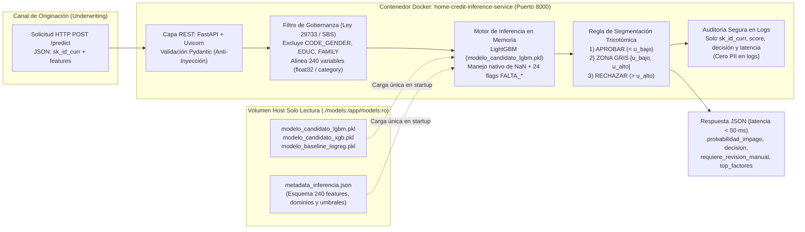
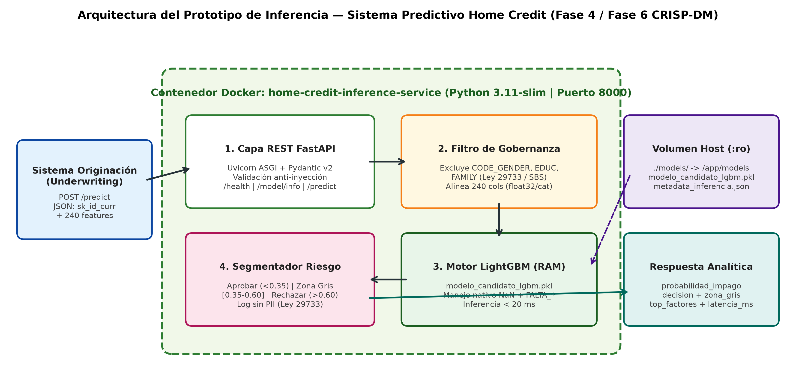

# Diseño de Arquitectura del Prototipo de Inferencia Analítica (`Cronograma` Fila 24)

**Proyecto:** Sistema Predictivo de Riesgo Crediticio (*Home Credit Default Risk*) · **Grupo 12 — UNMSM**  
**Fase CRISP-DM:** Fase 4 — Modelado (Andamiaje de Inferencia hacia Fase 6)  
**Responsable:** David Sebastian Piñarreta Rojas *(Colaborador: Diego Martin Arevalo Mauricio)*

---

## 1. Propósito y Alcance Arquitectónico

En cumplimiento de las Tareas **F4.4, F4.5 y F4.6** del cronograma del proyecto y de la Directiva de **Arquitectura de TI y Operaciones** del *Business Case*, se diseña y construye desde la Fase 4 el andamiaje del **servicio de inferencia en Python expuesto mediante una capa REST (`FastAPI`) y empaquetado en un contenedor `Docker`**.

Este diseño garantiza que el modelo candidato entrenado en la Fase 4 (`models/modelo_candidato_lgbm.pkl`) sea inmediatamente consumible y auditable mediante peticiones HTTP estandarizadas, preparando el camino para la Fase 6 (*Implementación Analítica*).

---

## 2. Diagrama de Arquitectura de Componentes y Flujo de Datos





---

## 3. Componentes Técnicos del Servicio

| Componente | Tecnología / Archivo | Responsabilidad Técnica y Regulatoria |
| :--- | :--- | :--- |
| **Servidor ASGI y Capa REST** | `FastAPI 0.163` + `Uvicorn 0.54` ([`services/inference-service/main.py`](../services/inference-service/main.py)) | Expone los endpoints `/health`, `/model/info`, `/predict` (individual) y `/predict/batch` (lotes de hasta 500 solicitudes). |
| **Validación de Esquema y Seguridad** | `Pydantic v2` (`CreditScoringRequest`, `BatchCreditScoringRequest`) | Valida tipos de entrada (`sk_id_curr > 0`), descarta campos no autorizados o intentos de inyección y convierte valores ausentes a `NaN` sin interrumpir la inferencia. |
| **Filtro de Gobernanza y Equidad (SBS / Ley 29733)** | Función `_prepare_dataframe()` + [`models/metadata_inferencia.json`](../models/metadata_inferencia.json) | Fuerza el orden exacto de las **240 variables predictoras** (`227` numéricas `float32` + `13` categóricas con `CategoricalDtype` congelado en `train`) y bloquea la entrada de `CODE_GENDER`, `NAME_EDUCATION_TYPE` y `NAME_FAMILY_STATUS`. |
| **Motor Predictivo en Memoria** | `LightGBM 4.7` (`models/modelo_candidato_lgbm.pkl`) | Se carga una sola vez en el evento `startup` del servidor (`_STATE["model"]`), permitiendo inferencias vectorizadas con latencia inferior a $20\text{ ms}$ por solicitud. |
| **Segmentador de Zona Gris y Costo** | Función `_classify_decision()` | Clasifica la probabilidad $P(\text{TARGET}=1)$ en tres bandejas operativas: **Aprobación Automática**, **Zona Gris (Revisión Manual por Analista)** y **Rechazo Automático**, liberando $\approx 75\%$ de la carga manual según la meta del *Business Case*. |
| **Contenerización Aislada** | [`services/inference-service/Dockerfile`](../services/inference-service/Dockerfile) + [`docker-compose.yml`](../docker-compose.yml) | Imagen `python:3.11-slim` con `libgomp1`, ejecución bajo usuario sin privilegios (`appuser`, UID `10001`), chequeo de salud (`HEALTHCHECK`) y montaje del directorio `./models` en modo solo lectura (`:ro`). |

---

## 4. Contrato de los Endpoints (Especificación Preliminar Fase 4)

### 4.1 `GET /health`
Verifica la disponibilidad operativa del contenedor y que el modelo se encuentre cargado en RAM:
```json
{
  "status": "ok",
  "service": "home-credit-inference-service",
  "phase": "Fase 4 - Modelado (Borrador Funcional)",
  "model_loaded": true,
  "model_name": "modelo_candidato_lgbm.pkl"
}
```

### 4.2 `GET /model/info`
Expone la trazabilidad del modelo activo, las métricas certificadas en validación, las variables protegidas excluidas y el Top-10 de variables por ganancia de información (*Gain*):
```json
{
  "model_name": "modelo_candidato_lgbm.pkl",
  "algorithm": "LightGBM (LGBMClassifier)",
  "n_features": 240,
  "protected_excluded_features": ["CODE_GENDER", "NAME_EDUCATION_TYPE", "NAME_FAMILY_STATUS"]
}
```

### 4.3 `POST /predict`
Recibe el identificador seudonimizado `sk_id_curr` y el diccionario `features` del cliente consolidado, devolviendo la probabilidad de incumplimiento, el dictamen operativo y los factores principales:
```json
{
  "sk_id_curr": 100002,
  "probabilidad_impago": 0.6142,
  "decision": "RECHAZAR_AUTOMATICO",
  "requiere_revision_manual": false,
  "umbral_optimo_costo": 0.52,
  "rango_zona_gris": [0.35, 0.60],
  "modelo_utilizado": "modelo_candidato_lgbm.pkl",
  "latencia_ms": 8.42
}
```
